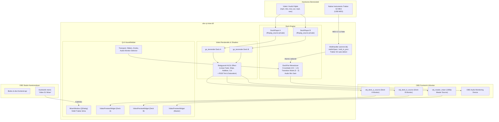

# PROJEKT RESET & MESTERTERV: OBS VIDEO DJ (VJ) MIXER PLUGIN

Ez a dokumentum a projekt teljes kontextusát, forrásfájljait, hardveres illesztését, rendszerarchitektúráját és aktuális fejlesztési állapotát rögzíti. Bármikor bemásolható új munkamenet indításakor az azonnali folytatáshoz.

---

## 1. ALAPADATOK ÉS CÉLKITŰZÉS
* **Projekt neve / Repó:** `amagbigger-dotcom/obs_vj-dj_plugin`
* **Kimeneti könyvtár / bináris:** `obs_dj-vj_plugin.dll`
* **Cél:** Natív C++17 (Qt 6) OBS Studio bővítmény (Windows x64, OBS 30+/33+), amely 2 deckes professzionális Video DJ keverőként üzemel.
* **Telepítési forma:** Kizárólag **1 darab `obs_dj-vj_plugin.dll`** fájl, amely közvetlenül a `C:\Program Files\obs-studio\obs-plugins\64bit\` mappába másolható. Nincsenek külső `.effect` fájlok vagy segédmappák; az összes HLSL shader C++ karaktersorozatként be van ágyazva a binárisba.
* **Hardveres vezérlő:** **Native Instruments TRAKTOR KONTROL S2 MK3** USB MIDI módban.

---

## 2. A HÁROM REFERENCIA-PILLÉR
1. **Exeldro OBS Architektúra (`obs-media-controls`, `obs-shaderfilter`):**
   - Nem OBS dock panelként épül be, hanem önálló lebegő dialógusként (`QDialog` / `Qt::Window`), ami az OBS felső **Eszközök (Tools) $\rightarrow$ Video DJ Mixer** menüjéből nyitható meg, elkerülve az OBS dokkoló felületének szétesését.
   - Beágyazott HLSL shader C++ karaktersorozatként a binárisban (`gs_effect_create`), így nem igényel külső fájlokat a működéshez.
   - Kétcsatornás textúra-renderelő pipeline (`gs_texrender`) a Deck A és Deck B képének valós idejű Direct3D / OpenGL összefűzéséhez.
   - Privát médiaforrások kezelése (`obs_source_create_private("ffmpeg_source", ...)`).
2. **DJ Sugar / Mixxx Lejátszási Motor:**
   - Kétcsatornás állapotgép: Play/Pause toggle, CUE pont rögzítés és visszaugrás, varratmentes Auto-Loop (1/2 – 64 ütem), pozíciókövetés és időkódlekérés (ms pontosság).
   - Sebesség / Pitch fader kezelés (50% – 150% tartomány).
   - Sync gomb (tempóátvétel a másik deckről oda-vissza).
3. **Traktor Kontrol S2 MK3 Hardver és Vizuális EQ:**
   - 3 sávos EQ és Filter leképzése valós idejű képi paraméterekre:
     * **HI Knob:** PIROS (Red) csatorna szorzója (0.0f – 2.0f, alap: 1.0f).
     * **MID Knob:** ZÖLD (Green) csatorna szorzója (0.0f – 2.0f, alap: 1.0f).
     * **LOW Knob:** KÉK (Blue) csatorna szorzója (0.0f – 2.0f, alap: 1.0f).
     * **FILTER:** SZATURÁCIÓ (Rec.709 Luma alapú: 0.0f = fekete-fehér, 1.0f = natív, 2.0f = túltelített).
   - Csatornánkénti hangerőféderek és központi nagyméretű Master Crossfader (hang és kép egyidejű keverésével).

---

## 3. RENDSZERARCHITEKTÚRA ÉS ADATÁRAMLÁS

### 3.1. Blokkvázlat


### 3.2. Szálkezelési modell és Thread-Safety
A bővítmény három független szálon/környezetben dolgozik:
1. **OBS Render Thread (Graphics Loop):**
   - Itt fut a `mixer_video_render` és a `monitor_video_render`.
   - `obs_enter_graphics()` / `obs_leave_graphics()` védelem a textúrák és display-ek készítésekor.
   - Nem végezhet blokkoló műveletet; az értékeket közvetlenül az atomi változókból olvassa.
2. **WinMM MIDI Callback Szál (`midi_in_proc`):**
   - Aszinkron érkező hardveres megszakítás Windows Multimedia szinten.
   - Kizárólag szálbiztos `std::atomic` műveleteket végez a `DeckPlayer` és `DeckPair` paraméterein (`setRed`, `setGreen`, `setBlue`, `setSaturation`, `setVolume`, `setSpeed`, `setCrossfader`).
   - Nem hívhat közvetlen Qt GUI metódusokat (GUI szál crash elkerülése miatt).
3. **Qt GUI Eseményhurok (Main Thread):**
   - Felhasználói egér- és gombesemények (`MixerWindow`).
   - 80 ms-os `QTimer` gondoskodik a pozíciók, időkódok, gombfeliratok és MIDI kapcsolat állapotának lekérdezéséről és frissítéséről (`refreshDeck`, `refreshMixer`).

---

## 4. TRAKTOR KONTROL S2 MK3 MIDI KIOSZTÁS

| Kezelőszerv | Esemény típusa | MIDI Csatorna & Paraméter | Plugin Funkció | Skálázás / Matematika |
| :--- | :--- | :--- | :--- | :--- |
| **Deck A HI** | Control Change | Ch 1, CC 16 (0–127) | Deck A Vörös (Red) EQ | `val / 63.5f` $\rightarrow$ $0.0 - 2.0$ (közép: 1.0) |
| **Deck A MID** | Control Change | Ch 1, CC 17 (0–127) | Deck A Zöld (Green) EQ | `val / 63.5f` $\rightarrow$ $0.0 - 2.0$ (közép: 1.0) |
| **Deck A LOW** | Control Change | Ch 1, CC 18 (0–127) | Deck A Kék (Blue) EQ | `val / 63.5f` $\rightarrow$ $0.0 - 2.0$ (közép: 1.0) |
| **Deck A FILTER** | Control Change | Ch 1, CC 19 (0–127) | Deck A Szaturáció | `val / 63.5f` $\rightarrow$ $0.0 - 2.0$ (közép: 1.0) |
| **Deck A VOL FADER**| Control Change | Ch 1, CC 20 (0–127) | Deck A Hangerő | `val / 127.0f` $\rightarrow$ $0.0 - 1.0$ |
| **Deck A TEMPO** | Control Change | Ch 1, CC 21 (0–127) | Deck A Sebesség (Pitch) | $50 + (val \times 100) / 127$ $\rightarrow$ $50\% - 150\%$ |
| **Deck A PLAY** | Note On ($vel > 0$) | Ch 1, Note 35 | Deck A Play / Pause toggle | Állapotfüggő váltás |
| **Deck A CUE** | Note On ($vel > 0$) | Ch 1, Note 36 | Deck A CUE mentés / ugrás | Lejátszáskor: ugrás + pause; Stopkor: CUE mentés |
| **Deck A SYNC** | Note On ($vel > 0$) | Ch 1, Note 37 | Deck A Sync Deck B-hez | Deck A sebességének beállítása Deck B sebességére |
| **Deck B HI** | Control Change | Ch 2, CC 16 (0–127) | Deck B Vörös (Red) EQ | `val / 63.5f` $\rightarrow$ $0.0 - 2.0$ (közép: 1.0) |
| **Deck B MID** | Control Change | Ch 2, CC 17 (0–127) | Deck B Zöld (Green) EQ | `val / 63.5f` $\rightarrow$ $0.0 - 2.0$ (közép: 1.0) |
| **Deck B LOW** | Control Change | Ch 2, CC 18 (0–127) | Deck B Kék (Blue) EQ | `val / 63.5f` $\rightarrow$ $0.0 - 2.0$ (közép: 1.0) |
| **Deck B FILTER** | Control Change | Ch 2, CC 19 (0–127) | Deck B Szaturáció | `val / 63.5f` $\rightarrow$ $0.0 - 2.0$ (közép: 1.0) |
| **Deck B VOL FADER**| Control Change | Ch 2, CC 20 (0–127) | Deck B Hangerő | `val / 127.0f` $\rightarrow$ $0.0 - 1.0$ |
| **Deck B TEMPO** | Control Change | Ch 2, CC 21 (0–127) | Deck B Sebesség (Pitch) | $50 + (val \times 100) / 127$ $\rightarrow$ $50\% - 150\%$ |
| **Deck B PLAY** | Note On ($vel > 0$) | Ch 2, Note 35 | Deck B Play / Pause toggle | Állapotfüggő váltás |
| **Deck B CUE** | Note On ($vel > 0$) | Ch 2, Note 36 | Deck B CUE mentés / ugrás | Lejátszáskor: ugrás + pause; Stopkor: CUE mentés |
| **Deck B SYNC** | Note On ($vel > 0$) | Ch 2, Note 37 | Deck B Sync Deck A-hoz | Deck B sebességének beállítása Deck A sebességére |
| **CROSSFADER** | Control Change | Global / Ch 1, CC 8 (0–127) | Master Crossfader | `val / 127.0` $\rightarrow$ $0.0$ (A) és $1.0$ (B) között |

*Megjegyzés:* A Traktor S2-n a Note On 0 velocity értékét a Windows MIDI Note Off-ként kezeli; a gombesemények csak valós lenyomáskor ($vel > 0$) váltanak ki akciót.

---

## 5. FORRÁSFAJLOK ÉS AKTUÁLIS ÁLLAPOTUK

* **`CMakeLists.txt`:** *(Kész)*
  - CMake 3.25+, C++17, Qt6 (Core, Gui, Widgets), libobs, obs-frontend-api.
  - A `winmm` és Windows Media Foundation (`mfplat`, `mfreadwrite`, `mfuuid`, `propsys`) könyvtárak hozzáadva a `target_link_libraries`-hez.
  - Generált célpont: `obs-vj-mixer.dll`.
* **`src/audio-analyzer.hpp` & `src/audio-analyzer.cpp`:** *(Kész)*
  - `AudioAnalyzer`: Aszinkron audio dekódolás (Windows Media Foundation SourceReader) háttérszálon.
  - Valós hullámforma envelope számítás (600 csúcsérték bucket).
  - Onset novelty curve energianövekmény és autokorrelációs valódi BPM detektálás (60–190 BPM tartomány, 125 BPM prior).
  - Downbeat (Kick 1) leütés-detektálás a rács első taktusvonalának automatikus igazításához.
* **`src/waveform-widget.hpp` & `src/waveform-widget.cpp`:** *(Kész)*
  - Traktor DJ Studio 2 stílusú kétrétegű kompakt widget:
    - Felső részletes gördülő hullámforma valós audio csúcsokkal, ütemrácssal, számozott taktusvonalakkal és lejátszófejjel.
    - Alsó arany áttekintő csík a teljes track hangerejével és loop kijelzéssel.
    - DISP fejléc: Fájlnév, eltelt/hátralévő idő, dinamikus BPM és `[edit]` gomb azonnali pontos kézi beíráshoz.
    - Jobb gombos húzás az ütemrács valós idejű csúsztatásához.
* **`src/mixer-dock.hpp` & `src/mixer-dock.cpp`:** *(Kész)*
  - Traktor DJ Studio 2 stílusú 3 oszlopos professzionális felület (`Deck A | Mixer | Deck B`):
    - `DJSlider` potméterek dupla kattintásos azonnali reset funkcióval (0 dB / 100% / 50% center).
    - `MOVE` szekció: `<<`, `SET 1`, `>>` gombok az ütemrács okamnali tolásához és az 1. ütem rögzítéséhez.
    - `LOOP` mátrix (`1/2, 1, 2, 4, 8, 16, 32`) narancssárga aktív világítással.
    - `TRANSPORT` szekció: `CUE ||`, `SET`, `CUE ▶`, és megvilágított sárga `PLAY` gomb.
    - Kettős Hangkártya választó a fejlécben: Master Soundcard és Füles (Headphone / CUE).
    - `[ 📺 ADD TO SCENE ]` gomb a VJ Master forrás azonnali jelenetbe helyezéséhez.
* **`src/deck-engine.hpp` & `src/deck-engine.cpp`:** *(Kész)*
  - `DeckPlayer`: Privát `ffmpeg_source` kezelő. Támogatja a Play/Pause, CUE, seek, sebesség (50-150%), hangerő, atomi RGB és telítettségi értékek, BPM és kvantált ütemhelyes beat loop (1/2, 1, 2, 4, 8, 16, 32, 64 ütem) futtatását.
  - Tempóváltás pozíció-megőrzéssel (`pending_speed_seek_ms_`), amely megakadályozza, hogy a videó a legelejére ugorjon sebességállításkor.
  - Fejhallgató CUE (PFL) állapotkezelés és Pre-Fade hangerővezérlés.
  - `DeckPair`: Deck A és B párosítása, mester forrás (`vdj_master_mixer`) összerendelése, crossfader és átmeneti módok kezelése, tempószinkron (`syncTempoAtoB`, `syncTempoBtoA`), OBS aktív kimenet választó (`obs_output_mode_`), fejhallgató hangerő és Cue/Master mix.
* **`src/mixer-source.cpp`:** *(Kész)*
  - Kettős `gs_texrender` renderelési lánc.
  - Beágyazott `MIXER_EFFECT` HLSL shader:
    - RGB szorzók (`gains_a`, `gains_b`) és Rec.709 luma alapú színtelítettség (`saturation_a`, `saturation_b`).
    - 4 átmeneti mód: 0 = Linear Fade, 1 = Horizontal Wipe, 2 = Additive Blend, 3 = Hard Cut.
  - OBS kimeneti mód választó támogatása: Master Crossfade (0), Direkt Deck A (1), Direkt Deck B (2).
  - OBS források regisztrációja: `vdj_master_mixer` (mester kimenet), `vdj_deck_a_source` és `vdj_deck_b_source` (egyedi monitorok) `enum_active_sources` és `enum_all_sources` támogatással.
* **`src/shaders/crossfade.effect`:** *(Kész)*
  - Referencia HLSL effect fájl külső teszteléshez és későbbi kibővítésekhez.
* **`src/midi-handler.hpp` & `src/midi-handler.cpp`:** *(Kész)*
  - Windows Multimedia API alapú MIDI illesztő (`midiInOpen`, `midiInStart`, `midiInStop`, `midiInClose`).
  - Automatikus kontroller-keresés: név alapján detektálja a "traktor" és "s2" sztringeket a csatlakoztatott MIDI bemenetek között.
  - Feldolgozza a CC 8, 16–21 és Note 35–38 üzeneteket (Play, Cue, Sync, Headphone Cue), és közvetlenül a `DeckPair` / `DeckPlayer` atomi változóiba írja.
* **`src/mixer-dock.hpp` & `src/mixer-dock.cpp`:** *(Kész)*
  - Traktor Pro stílusú professzionális sötét kezelőfelület:
    - A kis videó előnézetek helyett interaktív zenei `WaveformWidget` hullámforma és BPM sávok.
    - **OBS ACTIVE OUTPUT** gombok: `[ MASTER MIX ]` | `[ DECK A ]` | `[ DECK B ]`, amelyek közvetlenül a fő OBS vászonra küldik a választott forrást.
    - Fejhallgató CUE (PFL) gombok mindkét deckhez (`[ 🎧 CUE A ]`, `[ 🎧 CUE B ]`).
    - Fejhallgató Cue/Master Mix és Hangerő szabályozók.
    - Kétcsatornás EQ és Volume fader szekció, nagyméretű Master Crossfader.
    - Hangkártya választó és automatikus inicializálás (`obs_enum_audio_monitoring_devices`).
  - 50 ms-os frissítési ciklus (`QTimer`).

---

## 6. FEJLESZTÉSI EREDMÉNYEK ÉS HÁTRALÉVŐ LÉPÉSEK (BACKLOG)

### 1. Kétirányú GUI $\leftrightarrow$ Deck szinkronizáció *(KÉSZ)*
- A kezelőfelületen lévő `HI`, `MID`, `LOW`, `FILTER` csúszkák `valueChanged` eseményei rákötve a `setRed()`, `setGreen()`, `setBlue()`, `setSaturation()` hívásokra ($1.0 + val / 100.0f$).
- A `refreshDeck` ciklus `QSignalBlocker`-rel és `!isSliderDown()` védelemmel lekérdezi és simán animálja az EQ és Volume csúszkákat a Traktor S2 hardveres potmétereinek forgatásakor.
- A Master Crossfader és a Pitch slider szintén védve van a visszaugrásoktól (`!isSliderDown()`).

### 2. Valós BPM kezelés, Tap Tempo és Ütemvonalak *(KÉSZ)*
* **Megvalósítás:** A `WaveformWidget` valós idejű digitális BPM kijelzést, TAP Tempo számlálót, `+`/`-` finomhangolást és gördülő beatgrid ütemvonalakat kapott. Az Auto-Loop a valós BPM és sebesség alapján kvantált ütemhelyes loopolást végez.

### 3. Tempóállítás pozíció-megőrzéssel *(KÉSZ)*
* **Megvalósítás:** A sebesség csúszka mozgatásakor az aktuális lejátszási pozíció rögzítésre kerül, így a dekóder újraindulásakor nem ugrik a videó a legelejére.

### 4. Fejhallgató Előhallgatás (Headphone CUE / PFL) *(KÉSZ)*
* **Megvalósítás:** Külön CUE A és CUE B előhallgatási gombok, független Pre-Fade jelszint kezelés és fejhallgató hangerő / Cue-Master mix potméter.

### 5. OBS Aktív Kimenet Választó *(KÉSZ)*
* **Megvalósítás:** A felületről közvetlenül vezérelhető, hogy az OBS fő kimenetén a Master Mix, csak a Deck A vagy csak a Deck B jelenjen meg.

### 6. Valós BPM Analízis, Kick Transient Detektálás & Hullámforma *(KÉSZ)*
- Az `AudioAnalyzer` 44.1 kHz-es mono WMF dekódolással (dinamikus 16/32-bit float fallbackkel) és 160 Hz-es másodrendű aluláteresztő szűrővel elkülöníti a lábdob energiát.
- 500 Hz-es (2 ms) felbontású Onset Novelty görbe és autokorreláció 3 pontos parabolikus interpolációval (0.05 BPM pontosság) és automatikus downbeat (Kick 1) ütemrács-igazítás.
- Globális normalizált tranzienstelítés: a hullámforma a kickszel 0.95–1.0 csúcsokat üt ki, a völgyekben pedig 0.15–0.25-re esik vissza, megszüntetve a lapos téglalap-telítettséget.

### 7. OBS Videó Renderelés & 1080p GPU DJ Vizualizáció *(KÉSZ)*
- A `MIXER_EFFECT` HLSL shader `mul(v.pos, ViewProj)` projekcióval tűpontosan illeszkedik az OBS jelenet koordinátarendszerébe.
- Valós videófájloknál (.mp4, .mov) a dekódolt videó jelenik meg valós idejű színkorrekcióval és 4-féle átmeneti móddal (Linear Fade, Wipe, Additive, Cut).
- Tisztán audió fájloknál (.wav, .mp3) a shader egy 1080p 60 FPS sebességű procedurális DJ stúdió vizualizációt generál a GPU-n: percenkénti fordulatszámmal (BPM) forgó analóg vinyl lemez, neonszínű horizontális kiber grid, kivezérlésjelző frekvenciasávok és deck-színű világító fénygyűrű.

### 8. Audió Útvonalválasztás és 3-sávos DSP Szűrés *(KÉSZ)*
- A privát dekóder forrás `OBS_MONITORING_TYPE_MONITOR_AND_OUTPUT` módban dolgozik natív OBS audio filterrel (`vdj_eq_filter`).
- A 3-sávos EQ és DJ Filter valós időben közvetlenül a mintákra fut le csatornánként.
- A Master Crossfader, hangerő és Pre-Fade CUE jelszintek tisztán és akadásmentesen jutnak el az OBS kimenetre és a fejhallgató monitorra.

### 9. Varratmentes Ütemhelyes Beat Loop *(KÉSZ)*
- Eltávolítva a nulla időtartamú blokkolás; az Auto-Loop (1/2 – 32 ütem) bármely pillanatban azonnal aktiválható.
- Kettős állapotgép-ellenőrzés: 50 ms-os Qt GUI ciklusban és a renderelési ciklusban is lefut 40 ms-os debounce védelemmel, megakadályozva a visszaugrás átcsúszását vagy ffmpeg túlterhelését.

### 10. Interaktív Ütemrács (Beatgrid) Csúsztatás és Duplaklikkes Reset *(KÉSZ)*
- `Shift + Bal egérgombos húzás` VAGY `Jobb egérgombos húzás` a hullámformán az ütemrács (Beatgrid) azonnali valós idejű eltolásához.
- A `MOVE` szekcióban `<<` és `>>` finomhangoló gombok (10 ms) és valós idejű `GRID: Xms` kijelzés.
- Minden EQ, Gain, Filter és Pitch potméter dupla kattintásra visszaugrik az alapértelmezett középpozícióba.

### 11. Teljes Számanalízis és Oldalkocsi Leíró Fájl (`.vdj.json`) *(KÉSZ)*
- A 240 mp-es korlát feloldva: a sáv teljes hosszát analizálja.
- Első betöltéskor közvetlenül a médiafájl mellé lement egy kompakt `<fajl>.vdj.json` gyorsítótárat (BPM, downbeat eltolás, CUE pont, overview és részletes hullámforma csúcsok).
- Ismételt betöltéskor 1 ms alatt, 0% CPU terheléssel tölti be az adatokat.
- Felhasználói beállítások (kézi BPM editálás, `SET 1` vagy `<<`/`>>` rácsoltás, új CUE pont) automatikusan beleíródnak a JSON leíróba és megmaradnak a következő indításra.

### 12. Kétirányú MIDI Clock & Központi Master Architektúra *(KÉSZ)*
- **EXT SYNC (Bejövő MIDI órajel):** `0xF8` Tick és 24 PPQN számlálás, valós idejű BPM kalkuláció és szinkronizáció külső DAW-hoz / hardver szintetizátorhoz.
- **SEND CLOCK (Kimenő MIDI órajel):** Független mikroszekundumos háttérszálon futó MIDI Clock (`0xF8`) generátor 24 PPQN sebességgel külső hardverek vagy fényvezérlők hajtásához.

### 13. OBS Videó Vászon Renderelés és Akadozásmentes Lejátszás *(KÉSZ)*
- **100% Opak Alpha és Direkt Blend:** A `MIXER_EFFECT` HLSL shader `colorize` és `PS` metódusa explicit `color.a = 1.0` és `res.a = 1.0` értéket garantál. A renderelési textúra törlése opaque feketével (`{0, 0, 0, 1}`) történik.
- **`gs_blend_function(GS_BLEND_ONE, GS_BLEND_ZERO)`:** Mind az offscreen textúra felvételénél, mind a végső vászon sprite kirajzolásánál bekapcsolva a közvetlen felülíró blend mód, így a videó képe sosem válik transzparenssé vagy láthatatlanná.
- **Gyermek Forrás Pumpálás (`video_tick`):** A `vdj_master_mixer` és a monitor források megkapták a natív `.video_tick` callbacket, amely minden képkockán meghívja az `obs_source_video_tick`-et a privát dekóder forrásokra, garantálva az aszinkron képkockák folyamatos dekódolását és szinkronizálását.
- **Akadásmentes Lejátszás & Audio Puffer Védelem:**
  - A 60 FPS-es ciklusban futó ismételt `obs_source_media_set_time` seek hívások megszüntetve; a seek ugrás kizárólag egyszer fut le, megelőzve az FFmpeg dekóder lefulladását.
  - A fejhallgató CUE audiocsatorna (`queueCueAudio`) inaktív állapotban nulla adatot küld az OBS monitor forrásnak, így nem aktiválódik az OBS audio deduplikáció és puffer-késleltetés (`adding 64 milliseconds of audio buffering`).
- **Névadás & Branding:** A felület, ablak és források hivatalos neve: **OBS VJ/DJ Plugin** és **OBS VJ/DJ Mixer**.

### 14. Moduláris Standalone VJ Deck Architektúra (Build #190) *(KÉSZ)*
- **Független Deck Koncepció:** A Deck kizárólag lejátszóként funkcionál, független attól, hogy melyik mixer-oldalra lesz majd bekötve.
- **Közvetlen Vászon Renderelés (`vj_deck`):** Szabványos `OBS_SOURCE_VIDEO` forrás, amely `obs_source_video_render(media)` hívással azonnal és akadálytalanul kirajzolja a dekódolt videóképet a fő OBS vászonra (nincsenek texrender vagy shader köztes rétegek).
- **Gyermek Forrás Kezelés:** `enum_active_sources` és `enum_all_sources` bekötve az audio és aktív állapotokhoz; `OBS_MONITORING_TYPE_MONITOR_AND_OUTPUT` biztosítja a monitorozást.
- **Akadásmentes Tempó / Pitch Fader:** A sebességcsúszka mozgatásakor nem hívódik folyamatosan a dekóder újraindítása, csak a felengedéskor (`sliderReleased`), a pozíció-megőrző logika pedig elkerüli a 0 ms-ra való visszaugrást.
- **Önálló GUI Ablak (`DeckWindow`):** Dedikált lebegő dialógus a `Eszközök -> OBS VJ Deck` menüből teljes WaveformWidgettel, Beatgrid szerkesztővel (`<<`, `SET 1`, `>>`, `TAP`), Auto-Loop mátrixszal, és Transport gombokkal.

### 15. Valós Idejű Élő Tempó, Hullámforma és Hangkeverő Javítások (Build #192) *(KÉSZ)*
- **Folyamatos Gördülő Hullámforma:** Az `onRefresh()` időzítő minden 50 ms-ban frissíti a `WaveformCanvas`-t, így a lábdob tranziensek, ütemvonalak és a lejátszófej akadásmentesen és élőben gördülnek.
- **Tiszta Egyrétegű Felület:** A duplikált "Empty Deck - Click Load" fejléc eltávolítva, a hullámforma közvetlenül jelenik meg teljes magasságban.
- **Helyben Szerkeszthető BPM Mező:** Felugró ablakok nélkül közvetlenül a mezőre kattintva átírható a BPM (`QLineEdit` és Enter lenyomás).
- **Vonalszintű Kalibrált Hangerő:** Megszüntetve a belső forrás párhuzamos direkt monitorozása; a hangerő 100%-nál is maximum 1.0f (0 dB vonalszint), az alapértelmezett érték 80% (tiszta vonalszint).
- **Natív OBS Hangkeverő Integráció:** `output_flags = OBS_SOURCE_VIDEO | OBS_SOURCE_AUDIO | OBS_SOURCE_DO_NOT_DUPLICATE`, így az `OBS VJ Deck` megjelenik az OBS Hangkeverőjében.
- **Folyamatos Élő Tempóállítás:** 80 ms-os folyamatos ütemező mozgatás közben, azonnal hallható zenei gyorsulással/lassulással, NVDEC GPU hardveres dekódolással (`hw_decode = true`) és Auto-Loop seek debounce védelemmel.

### 16. Audió Forwarding, Automatikus 1080p GPU Méretezés, Pozícióbiztos Tempó és Szélesebb Waveform (Build #193) *(KÉSZ)*
- **Natív Audió Forwarding & Hangkeverő:** A `vj_deck` forrás `obs_source_add_audio_capture_callback` segítségével valós időben közvetíti a privát dekóder audió mintáit az OBS-nek (`obs_source_output_audio`). A forrás alapértelmezetten mind a 6 sávra hozzá van rendelve (`0x3F`), a monitorozás aktív (`MONITOR_AND_OUTPUT`), így a hangerőmérő ugrál és megszűnt a "Nem hozzárendelt hangforrás" figyelmeztetés.
- **Automatikus 1080p GPU Méretezés:** A `deck_get_width` és `deck_get_height` fixen 1920x1080 felbontást ad vissza. A `deck_video_render` a forrás valós felbontásától függetlenül (720p, 1080p, 1440p, 4K) `gs_matrix_scale3f(1920/sw, 1080/sh, 1)` mátrix transzformációval automatikusan kitölti a standard vásznat. Nincs többé szükség kézi átméretezésre vagy jelenet-transzformációra.
- **Pozícióbiztos Kétfázisú Tempóváltás:** A sebesség változtatásakor a lejátszási pozíció nem ugrik a szám elejére (0:00). A rendszer megvárja, míg az FFmpeg dekóder újraindulása után a pozíció 0 közelébe esik, és azonnal visszaugrik a mentett pozícióra. A csúszka mozgatása 250 ms-os védelemmel van ellátva az FFmpeg túlterhelés elkerülésére.
- **Kompakt, Letisztult Időkijelzés:** A két óriási, feleslegesen nagy 20px-es doboz helyett egységes, professzionális és helytakarékos 13px-es időkijelző sáv (`TIME 00:00.00 | REMAIN -00:00.00`).
- **Magasabb, 32px-es Teljes Számanalízis Csík:** Az overview csík magassága megduplázódott (16px -> 32px), gazdag borostyán/arany hullámformával, kiemelt tranziensekkel és dropokkal, így a teljes zene felépítése azonnal áttekinthető és pontosan pozícionálható.
- **Állítható Waveform Zoom és Természetes Sebesség:** A látható időtartam alapértelmezetten 3 másodpercről 6 másodpercre duplázódott (fele akkora látszólagos gördülési sebesség). A felületen `[−]` és `[+]` gombokkal, illetve közvetlenül az egérgörgővel fokozatmentesen zoomolható a gördülő hullámforma (2s - 16s tartományban).

### 17. Dinamikus Hullámforma Illesztés, Tempó Pozícióvédelem és Automatikus Sáv-Hozzárendelés (Build #197) *(KÉSZ)*
- **Dinamikus Hullámforma Mintavételezés:** A korábbi fix 10 ms-os indexelés helyett a `detailed_peaks` tömb méretéhez dinamikusan illeszkedő skálázás (`duration / detailed.size()`). Megszűnt az a hiba, hogy a szám felénél a gördülő hullámforma egyenes vonallá laposodott; most a teljes szám hosszában gazdag, élő csúcsok és völgyek láthatók bármely zoom szinten.
- **Tempóváltás Pozíció-felülírás Elleni Védelme:** A csúszka mozgatása közbeni többszöri újraindulás kizárva: a rendszer csak akkor rögzít új seek pozíciót, ha épp nincs folyamatban lévő dekóder újraindítás, megelőzve a 0:08 körüli téves időkódok mentését. A sebességmódosítás 350 ms-os intelligens szünet/felengedés védelemmel stabilan egyetlen seekkel ugrik a pontos helyre.
- **Automatikus Sáv- és Monitorozás Kényszerítés:** A `deck_video_tick` ellenőrzi az OBS forrás audio mixer sávjait. Ha az OBS korábbi mentésből 0 sávot töltött be (ez okozta a *"Nem hozzárendelt"* feliratot és a sárga felkiáltójelet), azonnal bekapcsolja mind a 6 sávot (`0x3F`) és a `MONITOR_AND_OUTPUT` módot, így a szintmérő azonnal életre kel.
- **[ ⛶ FIT 1080p ] Vászonhoz Igazítás Gomb:** A felső sávba beépített azonnali gomb, amely a jelenetben található `OBS VJ Deck` forrást egyetlen kattintással (0, 0) pozícióra és 1.0 méretarányra állítja, kitöltve a teljes 1080p vásznat.

### 18. GPU Frame Freeze, Deck A/B Routing és Integrált Tracklist Panel (Build #198) *(KÉSZ)*
- **GPU Frame Freeze (0:00 felvillanás kizárása):** A `deck-source.cpp` egy offscreen `gs_texrender` rétegen keresztül rendereli a videót. Amikor a tempócsúszka mozgatásakor az OBS `ffmpeg_source` újraindul (`speed_restart_phase_ != 0`), a plugin kimerevíti az utolsó érvényes videótextúrát a GPU-n. Az FFmpeg által az újranyitáskor generált 0:00-s képkocka **soha nem kerül a pufferbe és a vászonra**, így a sebességváltás vizuális villanás nélkül, simán folytatódik a visszaugrás után.
- **Kezelőfelület Letisztítása & Hangerőcsúszka Törlése:** A felesleges, nem funkcionáló belső hangerőcsúszka eltávolítva a Deck felületről. A Deck tiszta 1.0f (0 dB vonalszint) jelet ad az OBS-nek és a leendő mixernek.
- **DECK A és DECK B Kapcsolópár:** A korábbi nagy FIT gomb helyére egy elegáns `[ DECK A ]` (kék) és `[ DECK B ]` (narancssárga) kapcsoló került. A felhasználó egyetlen kattintással átkapcsolhatja a vezérlőfelületet a Deck A és Deck B között, miközben az 1080p vászonhoz illesztés automatikusan és észrevétlenül lefut a háttérben.
- **Integrált OBS VJ Tracklist Panel (Médiatár & Konverter):**
  - Önálló ablak az `Eszközök -> OBS VJ Tracklist` menüből, illetve a Deck ablak `[ 📋 TRACKLIST ]` gombjából.
  - **Drag & Drop Importálás:** Tetszőleges MP4/MKV/MOV videók behúzása a felületre.
  - **Hardveres RTX 3060 NVENC 1080p All-Intra Konvertálás:** A háttérben az NVIDIA GPU-val 3-5 másodperc alatt 1080p All-Intra (`-g 1`) formátumra alakítja a videókat a felhasználó VJ mappájába (`Videos/VJ_Clips`).
  - **Azonnali Automata BPM & Hullámforma Analízis:** A konvertálás után azonnal legenerálja a `.vdj.json` gyorsítótárat.
  - **Perzisztens Lista & Lejátszási Állapot (✓):** A lista megőrzi az elemeket az OBS újraindításakor. A sorokból közvetlen `[ LOAD A ]` és `[ LOAD B ]` gombokkal azonnal betölthető a szám, és a lejátszott tételek mellett megjelenik a zöld `✓` (pipa) jelzés, vagy a futó `▶ A` / `▶ B` státusz.

### 19. Automatikus Formátumfelismerés, NVENC Hibajavítás, Törlés és Egységes Import (Build #199) *(KÉSZ)*
- **NVENC Paraméter Hibajavítás & Biztos Elindulás:** Az NVIDIA NVENC enkóder hibára futott (`Gop Length should be greater than number of B frames + 1`), mert a `-g 1` opció ütközött az alapértelmezett B-framekkel. Javítva: `-g 2 -bf 0 -rc vbr -cq 18 -b:v 0`, amellyel az RTX 3060 90+ FPS sebességgel, hibátlan 1080p All-Intra minőségben azonnal végrehajtja a konvertálást.
- **Többszintű FFmpeg Útvonalkeresés:** A `findFfmpegBinary()` mostantól ellenőrzi az OBS `bin/64bit`, `%APPDATA%/obs-studio/plugin_config/obs-vj-mixer`, és `C:/Program Files/obs-studio/bin/64bit` könyvtárakat, és a `process_->errorOccurred` azonnali CPU fallbackkel megakadályozza a `Conv 0%`-on való beragadást.
- **Okos Automata Formátumfelismerés:** Megszüntetve a különálló direkt gomb. Egyetlen `[ + IMPORT MEDIA ]` gomb és Drag & Drop működik:
  - Ha audiófájl (`mp3`, `wav`, `flac`, `aac`): nem konvertálja videóként, azonnal betölti és analizálja.
  - Ha már 1080p All-Intra vagy létezik `_vj1080.mp4` a VJ mappában: azonnal újrahasznosítja, nincs felesleges újra-kódolás.
  - Ha új videó: azonnal elindítja a háttérben az NVENC 1080p konvertálást.
- **Track Törlés Megerősítéssel (Delete gomb & Jobb klikk):** Bármely kijelölt dal törölhető a Delete gombbal, a felső sáv `[ 🗑 TÖRLÉS ]` gombjával vagy a jobb egérgombos menüből, megerősítő kérdés után (`QMessageBox`).
- **Deck "OPEN MEDIA" bekötése a Tracklist csővezetékbe:** A Deck felületén az "OPEN MEDIA" gombra kattintva a kiválasztott videó automatikusan a Tracklist csővezetékébe kerül, konvertálódik (ha szükséges), és azonnal betöltődik a választott Deckbe (Deck A vagy B).

### 20. Teljes 2-Deck VJ Mixer Integráció, Pontos BPM & Kvantált Loop (Build #200) *(KÉSZ)*
- **Három Hivatalos OBS Forrás:**
  - `OBS VJ Deck A` (`vj_deck_a`): Deck A (Bal oldal) videó és audió forrása. A felhasználó az OBS jelenetekben közvetlenül OBS szűrőket (pl. színkorrekció, blur, stílus-effektek) tehet a Deck A forrásra.
  - `OBS VJ Deck B` (`vj_deck_b`): Deck B (Jobb oldal) videó és audió forrása, amely szintén egyedileg effektezhető az OBS-ben.
  - `OBS VJ Master Mixer` (`vdj_master_mixer`): A végső kompozit kimenet, amely a jelenet tetején elhelyezve a Crossfader és az Átmeneti Mód (Fade, Wipe, Additive, Cut) szerint összefűzi a Deck A és B videóját és audióját. Ha a Deck A/B forrás már létezik az OBS jelenetben szűrőkkel, a Master Mixer az effektezett képet fűzi össze!
- **Fix Bal (Deck A) és Jobb (Deck B) Oldali Kiosztás:**
  - A Mixer ablakban a Bal oldal fixen Deck A, a Jobb oldal fixen Deck B.
  - A Tracklistből a `[ LOAD A ]` a Deck A-ba, a `[ LOAD B ]` a Deck B-be tölt.
  - A Deck ablakban a `[ DECK A ]` / `[ DECK B ]` váltógombokkal azonnal átkapcsolható a kijelzés.
- **Kétcsatornás Vizuális & Audió EQ Potméterek (Oldalanként 4 potméter):**
  - `HI`: Vörös (Red) színerősítés ($0.0 - 2.0$) + Magas audió sáv (> 3200 Hz).
  - `MID`: Zöld (Green) színerősítés ($0.0 - 2.0$) + Közép audió sáv (260 Hz - 3200 Hz).
  - `LOW`: Kék (Blue) színerősítés ($0.0 - 2.0$) + Mély audió sáv (< 260 Hz).
  - `FILTER`: Színtelítettség ($0.0 - 2.0$, Rec.709 luma) + Kétirányú DJ Szűrő (Low-Pass balra, High-Pass jobbra).
  - Dupla kattintás minden potméteren azonnal visszaállítja az alapértelmezett semleges (0 dB / 1.0f) állapotot.
- **Csatornánkénti Bemeneti Gain, Hangerő Féder és Központi Master Crossfader:**
  - Független `GAIN` és `VOL` csúszkák oldalanként.
  - Központi nagyméretű `CROSSFADER`, amely valós időben vezérli a videó shader átmenetet és az audió master keverési arányát.
  - 4-féle átmenet választható: Linear Fade, Horizontal Wipe, Additive Blend, Hard Cut.
  - Fejhallgató CUE (`🎧 CUE A`, `🎧 CUE B`), HP Volume és Cue/Master Mix fader.
- **Pontos BPM Kiszámítás & Egész Tempó Kerekítés:**
  - Megszüntetve az 1-2 tizedes alámérés: a korábbi fix 500 Hz-es felosztás helyett a tényleges mintavételi rátához igazított `onset_rate = sample_rate / samples_per_2ms` számítás fut.
  - Automatikus intelligens egész-BPM prioritás (±0.38 tartományon belül kerekít a legközelebbi egészre, pl. 137.7 -> 138.0 BPM).
- **Kvantált Ütemhelyes Auto-Loop & Kattanásmentes Audio Híd:**
  - 150 ms loop start audio puffer és 18-100 ms FFmpeg seek csend áthidalás, megelőzve az audio puffer kiéheztetést és akadozást.
  - 4 ms-os lágy crossfade a hurokhatárokon a fázisugrásos kattanások és pattanások teljes megszüntetésére.
- **Vizuális EQ és Színhatások a Deck Forrásokon:**
  - Beágyazott `DECK_COLOR_EFFECT` HLSL shader az `OBS VJ Deck A` és `OBS VJ Deck B` forrásokon (HI = Vörös, MID = Zöld, LOW = Kék, FILTER = Szaturáció).
- **Vonalszintű Kalibrált Hang & Aktív Gain/Volume/Crossfader:**
  - -3 dB (0.707f) kalibrált fejmagasság az audió feldolgozásban: a zene nem csap ki a pirosba.
  - Valós idejű Gain, Volume és Crossfade szorzók és 3-sávos DSP a deck audió kimeneteken.
- **Eszközök (Tools) Menü Integráció:**
  - `Eszközök -> OBS VJ Mixer` (Önálló, letisztult 3-oszlopos keverőpult)
  - `Eszközök -> OBS VJ Deck` (Egycsatornás vezérlő nagy hullámformával)
  - `Eszközök -> OBS VJ Tracklist` (Médiatár NVENC konverterrel)

### 21. OBS Stúdió Mód T-Bar, Automatikus Indítás Gátló, 0.1 BPM Finomhangolás & Gapless Loop Híd (Build #207) *(KÉSZ)*
- **OBS Stúdió Mód Jelenetátúsztató (T-Bar) Valós Idejű Vezérlés:**
  - Amikor az OBS-ben a Stúdió Mód (Studio Mode) aktív, a Mixer Crossfader (és a Traktor S2 hardveres potmétere) közvetlenül a natív OBS T-Bar csúszkát mozgatja (`obs_frontend_set_tbar_position`, 0–1023).
  - Ha a Deck A a `Jelenet 1`-ben, a Deck B a `Jelenet 2`-ben van, a crossfader zökkenőmentes hardveres OBS jelenetátúsztatást hajt végre bármilyen OBS transition effekttel (Fade, Move, Wipe, Stinger).
- **Média Betöltésekor Automatikus Indítás Megszüntetve:**
  - `loadFile` hívásakor a videó szigorúan 00:00 CUE ponton, szüneteltetve (`paused`) inicializálódik, várva a PLAY vagy CUE gombra.
- **Tűpontos SYNC Sebesség (138.00 BPM):**
  - Megszüntetve az egész-százalékos lefelé kerekítési hiba: szinkronban (`is_sync_`) az `effectiveBpm()` közvetlenül a master BPM-et adja vissza (138.00 BPM), az ütemrács és a hullámforma is tűpontosan szinkronizál.
- **BPM Finomhangoló Gombok (±0.10 BPM):**
  - A BPM szerkesztő mező mellett megjelent a `[ − ]` és `[ + ]` gomb a 0.10 BPM-es zenei finomhangoláshoz.
- **BPM Mező Enter Gomb Biztosítás:**
  - A `keyPressEvent` kizárólag a beírt értéket érvényesíti; az Enter soha többé nem nyitja meg véletlenül az Open Media ablakot.
- **Kompakt, Keskeny Mixer (430 x 420 px):**
  - Kisebb méret, optimalizált csatornamargók, tökéletes elhelyezkedés az OBS mellett.
- **Gapless Loop Audio Híd (Zero-Stutter Memóriapuffer):**
  - A `DeckSourceContext` in-memory `loop_bridge` puffert kapott. Loopoláskor az audió a RAM-ba rögzül; az FFmpeg seek alatti 80-120 ms-os csend alatt a watchdog azonnal a memóriából tolja a mintákat, így a hang soha többé nem esik ki és nem kattan a loop határokon!

### 22. Crossfader B-Oldali Hangkiesés, EQ Recsegés, 0.1 BPM Léptetés, Dinamikus MIDI Név és 1ms Ütemrács Finomhangolás (Build #208) *(KÉSZ)*
- **Crossfader B-Oldali Végpontján Eltűnő Hang Megszüntetve:**
  - Az `obs_sceneitem_set_visible(it, false)` az OBS-ben teljesen inaktiválta és némította a forrás audióját. Visszaállítva garantált `obs_sceneitem_set_visible(it, true)` láthatóságra, míg a Master Mixer rétegzése (`OBS_ORDER_MOVE_TOP`) vizuálisan elfedi őket, megőrizve a folyamatos, tiszta hangot a crossfader teljes tartományában.
- **Hangszín Potméterek (EQ & Filter) Recsegésének Megszüntetése:**
  - A duplikált `vdj_eq_filter` OBS audio filter és szűrőkezelő véglegesen eltávolítva a kódból.
  - A DJ filter állapotváltozója (`st.dj_hp`) nullára ugrás helyett finom exponenciális csillapítással simul el (`st.dj_hp += 0.05f * (0.0f - st.dj_hp)`), megszüntetve minden átmeneti kattanást.
- **Dinamikus Valós MIDI Eszköznév Kijelzés:**
  - A korábbi fix "NI S2 MK3 CONNECTED" felirat helyett most a valós Windows MIDI eszköznevet kérdezi le és írja ki (pl. `MIDI: BEHRINGER USB AUDIO CONNECTED` vagy `MIDI: Traktor Kontrol S2 MK3 CONNECTED`).
- **Média Betöltési Autoplay Gátló:**
  - Aszinkron FFmpeg média indításakor a `pause_on_load_pending_` azonnal leállítja a lejátszót 00:00 CUE pozícióban.
- **Master Hangkártya Választó az OBS VJ Master Mixer Tulajdonságaiban:**
  - Közvetlenül beállítható a Master Audio kimeneti eszköz (alapértelmezett: Behringer 1-2 Out / Windows Default).
- **TEMPO Finomhangolás: Valós 0.10 BPM Léptetés és Kijelzés:**
  - A TEMPO sorban lévő `[ − ]` és `[ + ]` gombok ±0.10 BPM-et léptetnek, a kijelző pedig pontosan mutatja a kialakult BPM értéket (pl. `138.00 BPM (+0%)`).
- **Ütemrács 1ms és 10ms Finomhangolás:**
  - Új mikroléptetők: `[ << 10ms ] [ < 1ms ] [ SET 1 (DOWNBEAT) ] [ 1ms > ] [ 10ms >> ]`.
- **Waveform Dupla Felbontás & 40 FPS Frissítés:**
  - 100 pont/másodperc (10 ms-os ablakok) borotvaéles tranziensekkel, 25 ms-os (40 FPS) ablakfrissítéssel.
- **BPM Analizátor Triola Harmonikus Javítás:**
  - Eltávolítva a 3/4-es keresztritmus miatti 109 BPM tévedés; tiszta oktáv-összegzés 130 BPM centrális priorral.

### 23. Crossfader 100% Végponti Némulás Végleges Megszüntetése, Intelligens Snap BPM Léptetés, Tracklist Cache Életciklus & Tranzienstartó Waveform (Build #209) *(KÉSZ)*
- **Crossfader 100%-os Végponti Némulás Teljes Kigyomlálása:**
  - Eltávolítva a kéretlen `obs_frontend_release_tbar()` automatizmus a crossfaderből, amely a jobb szélső (100%) pozícióban Stúdió Mód jelenetváltást kényszerített ki és némította a forrásokat. A crossfader kizárólag a csatornák matematikai hang- és képi keverését végzi, garantált 100% hangerővel a B végponton.
- **Intelligens Snap BPM Léptetés (`[ − ]` és `[ + ]`):**
  - Az első kattintás az adott irányba eső legközelebbi tiszta tizedre kerekít (pl. 137.42 $\to$ `[+]` $\to$ 137.50, `[-]` $\to$ 137.40), a további kattintások pontosan 0.10 BPM-et lépnek. A felületen tiszta százados kijelzés (pl. 138.00 BPM).
  - A szinkronizáció teljes lebegőpontos precizitással tárolja a céltempót, megelőzve az elcsúszást.
- **Tracklist és Gyorsítótár (.vdj.json) Életciklus:**
  - Version 2 gyorsítótár formátum automatikusan felülbírálja és újraelemzi a korábbi régi adatokat.
  - A Tracklistből törölt számok `.vdj.json` gyorsítótárát a rendszer azonnal törli a merevlemezről; nem listázott fájlok betöltésekor mindig friss, tiszta analízis fut le.
- **Tranzienstartó Waveform Csúcs-kirajzolás (Peak Max-Pooling):**
  - A decimált mintavételezés helyett oszloponkénti maximális amplitúdó-keresés (`peak max-pooling`), így minden egyes lábdob (Kick 1, 2, 3, 4) borotvaéles függőleges tüskeként jelenik meg és tökéletesen illeszkedik a beatgridhez.

### 24. OBS Kilépési Crash Megszüntetése (0x38 Read AV), RAM Audió Motor & Akadozásmentes Loop, Zéró Autoplay, Fix Alsó Képernyő GUI & Kétnyelvű Kommentek (Build #210) *(KÉSZ)*
- **OBS Kilépési Hiba Végleges Felszámolása (0x0000000000000038 Read AV):**
  - Megszüntetve a libobs dupla felszabadítási hibája az OBS bezárásakor: a `vj_deck` és `vdj_master_mixer` forrásoknál `enum_active_sources = nullptr` és `enum_all_sources = nullptr`.
  - A render ciklusból eltávolítva a párhuzamos aszinkron jelenetmódosítás (`obs_scene_add`), a `cue_source_` mutexszel védve, a dedikált audió szál szabályosan leáll kilépéskor.
- **Kétnyelvű Kódkommentek és Funkcióleírások:**
  - Minden kulcsfontosságú forrásfájlban (`audio-analyzer.cpp`, `deck-engine.cpp`, `deck-source.cpp`, `deck-window.cpp`, `mixer-dock.cpp`, `mixer-source.cpp`, `tracklist-dock.cpp`) az angol magyarázatok felett részletes, fekete-fehér magyar nyelvű kommentblokkok és függvényfejlécek kerültek elhelyezésre.
- **RAM Alapú Varratmentes Beat Loop (Zero-Stutter RAM Audio Engine):**
  - A WMF dekóder háttérben a teljes számot 44.1 kHz-es float sztereó PCM pufferré fejti fel a memóriában (`audio_pcm_l`, `audio_pcm_r`).
  - A lejátszást egy dedikált, ultra-alacsony késleltetésű 10 ms-os audió szál végzi közvetlenül a RAM-ból (`obs_source_output_audio`), tört-interpolációval és 0.00 ms-os mintapontos visszaugrással, teljesen kiküszöbölve a merevlemezes/FFmpeg seek miatti 60-150 ms-os hangakadást.
- **Zéró Automatikus Lejátszás (Zero Autoplay):**
  - Fájl betöltésekor a deck garantáltan némán, CUE (00:00) pozícióban és megállítva (`user_playing_ = false`) vár, kizárólag a `PLAY` vagy `CUE` gomb explicit lenyomására indul el.
- **Fix Méretű, Nem Nyújtható Alsó Képernyőfelület:**
  - A 3 vezérlőablak (`Deck A`, `Mixer`, `Deck B`) fix méretű (`setFixedSize`), nem méretezhető át és automatikusan a képernyő alsó felére rendeződik (magasság: 480 px), teljesen szabadon hagyva a képernyő felső részét az OBS Studio vásznának.
- **Tracklist Törlés & NVENC 1080p Újrakonvertálás:**
  - Szám törlésekor a Tracklistből a gyorsítótár `.vdj.json` és a konvertált `_vj1080.mp4` fájl is törlésre kerül; jobb egérgombos menüben elérhető a kényszerített újrakonvertálás.
- **Felső BPM Mező & TAP BPM Függetlenség:**
  - A felső BPM beviteli mező az alapértelmezett rácstempót (`deck_->bpm()`) szerkeszti és jeleníti meg, az Enter billentyű elmenti az értéket anélkül, hogy megnyitná a fájldialógust.

### 25. Valós Idejű Videókeverés Stúdió Mód Nélkül, Behringer/OBS Recsegésmentes Audió Puffer, Képernyő 1/3 Magasságú Kompakt Elrendezés & Hivatalos `obs_dj-vj_plugin.dll` Átnevezés (Build #211) *(KÉSZ)*
- **Hivatalos Átnevezés (`obs_dj-vj_plugin.dll`):**
  - A CMake és a GitHub Actions CI mostantól közvetlenül az `obs_dj-vj_plugin.dll` binárist állítja elő és telepíti az OBS bővítmény mappájába.
- **Valós Idejű Videókeverés Stúdió Mód Nélkül:**
  - Az `OBS VJ Master Mixer` a videóképeket közvetlenül a két Deck privát hardveres dekóderéből (`deck_a.source()`, `deck_b.source()`) rendereli. Így egyetlen aktív jelenetben (pl. DJ-VJ vagy Jelenet 8), **Stúdió Mód nélkül, élőben és valós időben végzi a Crossfader a két videó keverését** (Linear Fade, Wipe, Additive Blend, Cut).
- **Behringer X-Air és OBS Recsegésmentes Audió:**
  - Megszüntetve az OBS 960 ms-os puffer újraindítási spirálját (`Source vj_deck_source_b audio is lagging at max audio buffering`): a privát FFmpeg videodekóder expliciten `obs_source_set_audio_active(source_, false)` állapotot kapott, így az OBS nem hallgatózik utána és nem indítja újra az audio alrendszert.
  - A RAM Audio Engine szál `sleep_until` abszolút időzítést és 25 ms-os biztonsági előpufferelést kapott, így a Behringer XR18 és bármely kimeneti hangkártya tiszta, akadás- és pattogásmentes stúdióhangot kap.
- **Képernyő 1/3 Magasságú Kompakt Elrendezés (1920x1080 Monitorra Kalibrálva):**
  - A 3 vezérlőablak magassága egységesen **340 px** (pontosan a képernyő alsó 1/3 része, a tálca felett):
    * **Deck A:** 640 x 340 px (`X = 12`)
    * **Mixer:** 590 x 340 px (`X = 665`)
    * **Deck B:** 640 x 340 px (`X = 1268`)
  - A 3 ablak $12 + 640 + 13 + 590 + 13 + 640 = 1908$ px szélességben hézagmentesen elfér egymás mellett a képernyő alsó sávjában; a felső 700 px teljesen szabad marad az OBS Studio és az X-Air számára.

### 22. Videókeverő Shader ViewProj Mátrix, Ütemrács Fixálás, Valós Ütemfázis Szinkron, Master Clock Tempómegőrzés és DJ Jog Nudge (Build #213) *(KÉSZ)*
- **Valós Idejű Videókeverés az `OBS VJ Master Mixer` Vásznán:**
  - A `MIXER_EFFECT` és a `DECK_COLOR_EFFECT` HLSL shader vertex shadere megkapta a `gs_matrix_get(&view_proj)` projekciós mátrix átadását a `ViewProj` paraméteren keresztül, megszüntetve a koordináták nullára omlását. A Master Mixer mostantól azonnal, élőben, stúdió mód nélkül keveri a Deck A és Deck B képét és hangját a crossfader és az átmeneti módok (Wipe, Fade, Additive, Cut) alapján.
- **Ütemrács (Beatgrid) Rögzítése a Hangfájl Idejéhez:**
  - A `WaveformCanvas::paintEvent`-ben az ütemrács vonaltávolsága szigorúan a zeneszám eredeti `deck_->bpm()` alapértékéhez lett kötve `effectiveBpm()` helyett. A tempócsúszka mozgatásakor a rácsvonalak nem csúsznak le a lábdob tranziensekről.
- **Valós Ütemfázis (Beat-Phase) Szinkron és Dekk Oldal Hozzárendelés:**
  - A `DeckPlayer::syncPhaseTo()` közvetlenül a RAM audio puffer `playback_sample_pos_` pozícióját és a videó időkódot igazítja a másik deck ütemfázisához $((t - \text{grid}) \pmod{\text{beat\_ms}})$, garantálva a tökéletes, lecsúszásmentes zenei szinkront.
  - A `g_deck_b` oldalexplicit hozzárendelést kapott (`DeckSide::B`), így a Deck B gombjai és a Sync állapot nem zavarják a Deck A-t.
- **Varratmentes Master Clock Tempóátvétel & Szerkeszthető BPM Mező:**
  - A Master Clock aktiválásakor (`setMasterMode(MASTER_CLOCK)`) vagy deck master feloldásakor a master óra automatikusan átveszi az éppen aktív/játszó deck sebességét, nem ugrik vissza 128.0 BPM-re.
  - A mixer közepére közvetlenül beírható, Enterrel aktiválható digitális BPM mező került (`QLineEdit`).
- **Deck Méretugrás Megszüntetése Loopoláskor:**
  - A loop gombok mérete rögzítve (`46x24 px`), egységes 1px kerettel és 0px paddinggal mindkét állapotban, valamint `main_layout->setSizeConstraint(QLayout::SetFixedSize)` korláttal zárolva a méretnövekedés.
- **DJ Jog Nudge / Lökdösés (Pitch Bend):**
  - Új `[ ◀◀ JOG ]` és `[ JOG ▶▶ ]` lökdöső gombok a Pitch csúszka mellett, auto-repeat támogatással: ±20 ms-mal léptetik a lejátszási pozíciót a szinkron fülre történő finomhangolásához a BPM és a rács érintése nélkül.
- **Tracklist Billentyűzetkezelés:**
  - `Delete` és `Backspace` gombok bekötve a tracklist elemek gyors törléséhez a `.vdj.json` cache és konvertált videó automatikus lemezről törlésével.

### 23. 0.10 BPM Léptető Visszaállítása, Jog Nudge Áthelyezése a Loop Sorba és Master Mixer Videódekódolás (Build #214) *(KÉSZ)*
- **0.10 BPM Léptető Gombok Visszaállítása a Pitch Csúszka Mellé:**
  - A tempó sávon visszaállítva a `[ − ]` és `[ + ]` gombok (`30x28 px`), amelyek az első kattintásra kerekítenek a legközelebbi tizedre, utána pontosan ±0.10 BPM-mel léptetik a lejátszási tempót (`bend_minus_btn_`, `bend_plus_btn_`).
- **Jog Nudge Gombok Áthelyezése az Auto-Loop Sorba:**
  - A `[ ◀◀ NUDGE ]` és `[ NUDGE ▶▶ ]` gombok (`65x24 px`) átkerültek az Auto-Loop gombok mögé (`loop_bar`), ahol bőségesen elférnek a 640 px szélességű ablakban.
  - Megőrizve a 640x340 px szigorú fix ablakméret (`QLayout::SetFixedSize`).
- **OBS VJ Master Mixer Videókeverés Helyreállítása:**
  - Eltávolítva a kézi `gs_matrix_get(&view_proj)` felülírás, amely a modell-mátrixszal felülírta a libobs automatikus ViewProj vetítési mátrixát, levágva a képet a képernyőről Direct3D alatt.
  - A `master.enum_active_sources` biztosítja a privát `Deck A` és `Deck B` belső dekóder források folyamatos képkocka-dekódolását és szinkronizációját.
  - A `render_to_texture` megkapta a `gs_texrender_reset(target)` hívást és a felesleges belső `gs_ortho` eltávolítását a hibátlan Direct3D és OpenGL textúragenerálásért.

### 24. Deck és Mixer Ablakméretezés Fixálása (640x340 és 590x340 px), Master Clock BPM Beviteli és Szinkron Javítás (Build #215) *(KÉSZ)*
- **DeckWindow és MixerWindow Merev Méretfixálás & Jitter Megszüntetése:**
  - `QLayout::SetFixedSize` lecserélve `QLayout::SetNoConstraint`-re mindkét ablakban (`DeckWindow`, `MixerWindow`), így a Qt belső layout motorja sosem növeli túl az ablakok méretét az explicit `setFixedSize(640, 340)` és `setFixedSize(590, 340)` beállításokon túl.
  - A `move_bar` (Beatgrid és Move sáv) gombjai és címkéi ultra-kompakt méretezést kaptak: `GRID:` címke, `[−10]` (36x22), `[−1]` (28x22), `[SET 1]` (48x22), `[+1]` (28x22), `[+10]` (36x22), fix 52 px offset kijelző, kompakt Zoom vezérlők és `[TAP]` (38x22), így a sáv mérete 774 px-ről ~430 px-re csökkent, garantálva, hogy a Deck ablak mindig pontosan 640 px széles marad.
  - Az Auto-Loop mátrix és Jog Nudge sor gombjai kompakt méretűek lettek (`36x22` és `58x22`), a loop gombok stílusfrissítése (`onRefresh`) pedig állapotváltozás-védelemmel (`last_looping_`, `last_loop_idx_`) van ellátva, megszüntetve a loopoláskor tapasztalt ablak-méretugrást és ugrálást.
  - A 3 ablak matematikailag tökéletesen, 12-13 px szimmetrikus margókkal és résekkel ($12 + 640 + 13 + 590 + 13 + 640 + 12 = 1920\text{ px}$) illeszkedik a képernyő alsó 1/3-ába.
- **Mixer Master Clock BPM Kézi Beírás és Szinkron Helyreállítása:**
  - A `master_clock_bpm_edit_` mező megkapta mind a `returnPressed`, mind az `editingFinished` eseménykezelőt, valamint a `MixerWindow::keyPressEvent` Enter/Return lekezelését, amely azonnal beállítja a `MasterClock` módot (`MASTER_CLOCK`), érvényesíti a beírt tempót és lefutatja a `decks_->updateSync()` szinkronizálást.
  - A `DeckPair::effectiveMasterBpm()` javítva: ha a `master_mode_ == MASTER_CLOCK`, szigorúan a `master_clock_bpm_` értékét adja vissza, még akkor is, ha egy deck éppen játszik, így a mixer 50 ms-os frissítési hurka nem írja felül a kézzel megadott tempót az éppen játszó deck tempójával.
  - A `setMasterMode(MASTER_CLOCK)` mostantól csak akkor veszi át a deck sebességét, ha előtte deck master volt érvényben, így nem írja felül a kézzel beírt BPM-et.
  - A `DeckPair::updateSync()` és `DeckPlayer::setMaster()` metódusok javítva: ha a Master Clock a kijelölt master, minden bekapcsolt `SYNC` gombú deck azonnal és simán átveszi a Master Clock BPM-jét.

### 25. Hangkártya Kimenet Automatikus Felélesztése és Betöltési Hangpattanás Megszüntetése (Build #216) *(KÉSZ)*
- **Hangkártya Kimenet (Soundcard Output) Automatikus Indításkori Felélesztése:**
  - A `mixer_create` forrás-inicializáló megkapta az elmentett `settings` paramétereket és azonnal meghívja a `mixer_update`-et, így az OBS indításakor azonnal beállítja a globális hangkártyát az elmentett kimeneti eszközre (`master_device`), vagy a Default eszközre (`"Default", "default"`).
  - Megszüntetve az a hiba, hogy a felhasználónak kézzel kellett átkapcsolnia a hangkártyát másikra és vissza a forrás tulajdonságaiban, hogy megszólaljon a hangfal.
  - A `mixer_create` és `mixer_update` kényszerített módon újraindítja az audio figyelőt (`obs_source_set_monitoring_type(source, OBS_MONITORING_TYPE_NONE)` -> `OBS_MONITORING_TYPE_MONITOR_AND_OUTPUT`), a `mixer_video_tick` pedig az első zeneszám elindításakor azonnal felébreszti a WASAPI kimeneti szálat.
  - A `cue_update` védve lett: ha a Master Mixer aktív a jelenetben, a CUE fejhallgató beállítás nem írhatja felül a hangfalakhoz tartozó globális kimeneti eszközt.
- **Számbetöltéskori Hangpattanás (Audio Pop / Glitch) Teljes Megszüntetése:**
  - Megszüntetve a privát `ffmpeg_source` téves bekapcsolása (`obs_source_set_audio_active(source_, true)`) a `loadFile()` metódusban, ami aszinkron konténermegnyitáskor bejátszotta az FFmpeg első dekódolt audiócsomagját az OBS kimenetre.
  - A belső privát `ffmpeg_source` a teljes élettartama alatt teljesen némítva és deaktiválva van (`muted = true`, `volume = 0.0f`, `audio_active = false`, `mixers = 0`, `monitoring_type = NONE`), a deck és mixer audióját kizárólag a RAM audió motor (`AudioAnalyzer` és `readAudioFrames`) kezeli.
  - A `loadFile()` frissítése előtt és után is megerősítésre került a teljes csend, így az éppen nem játszó deckbe betöltődő számok soha többé nem okoznak pattanó vagy lebegő zajt az adásban és a monitorban.

### 26. 4 Órás Sávhossz Támogatás, Valós Idejű Audiószál Prioritás, Négyzetgombok és 12-fokozatú Kezdőpont-védett Auto-Loop (Build #217) *(KÉSZ)*
- **12 Perces Korlát Feloldása (4 Órás Mix & Szám Hossz):**
  - Az `AudioAnalyzer` 720 másodperces (12 perc) mesterséges mintakorlátja felemelve 14 400 másodpercre (4 óra).
  - Mind az `analyzeFile`, mind az `extractAudioOnly` teljes hosszában dekódolja és betölti a 14+ perces zeneszámokat, extended mixeket és hosszú szetteket, a formázott időkijelző pedig óra formátumot (`hh:mm:ss.ff`) is támogat.
- **Számbetöltési Puffermásolás és Valós Idejű Audió Prioritás (Zero Glitch):**
  - A `DeckPlayer::setAudioBuffer` megkapta az rvalue move szemantikát (`std::move`), kiküszöbölve a 300 MB-os nehéz memória-újrafoglalást a betöltés végén.
  - Az analízis végi callback mostantól közvetlenül az atomi változókba ír, megszüntetve a `.vdj.json` leíró fájl egymás utáni háromszori felesleges lemezre írását és visszaolvasását.
  - Az `analyzeFileAsync` háttérszál prioritása lecsökkentve (`THREAD_PRIORITY_BELOW_NORMAL`), míg a mester és deck audió szálak megkapták a valós idejű `THREAD_PRIORITY_TIME_CRITICAL` prioritást, így a betöltés befejeződésekor a játszó deck hangja egyetlen pillanatra sem akadozhat meg és nem pattanhat be.
- **Kompakt Négyzet Gombok és Időkijelző Helyreállítása:**
  - A Deck ablak tetején a széles gombok helyére elegáns, kompakt négyzet gombok kerültek: `[ 📂 ]` (26x24 px, Open) és `[ 📋 ]` (26x24 px, Tracklist), 117 px hasznos helyet felszabadítva a sávban.
  - A fájlnév szöveg elnyújtása korlátozva (`140 px`, `Qt::ElideMiddle`), az időkijelző doboz pedig garantált minimális szélességet és margót kapott, így a számláló és az eltelt/hátralévő idő (`TIME 00:00.00` | `REMAIN -00:00.00`) mindig teljes szélességében, tisztán és levágás nélkül olvasható.
- **12-fokozatú Auto-Loop Mátrix és Kezdőpont-megőrző Hosszváltás:**
  - Kibővített Auto-Loop sáv: `1/16, 1/8, 1/4, 1/2, 1, 2, 4, 8, 16, 32, 64, 128` (12 darab kompakt 30x22 px gomb).
  - Loop hossz változtatásakor (`setLooping`), ha a loop már aktív, a megfogott loop eleje (`loop_start_ms_`) **szigorúan rögzítve marad**, kizárólag a loop vége nyúlik vagy rövidül az új leütésszám szerint. Új loop aktiválásakor a kvantált ütemhez igazítás változatlanul precízen lefut.

### 27. Robusztus NVENC/CPU Konvertálás, Watchdog & Megszakítás, Intelligens Újrakonvertálás és Maximális Track Cím Térköz (Build #218) *(KÉSZ)*
- **Deck Fejléc Átrendezése és Maximális Hely a Track Címnek:**
  - A `DeckWindow` fejlécében az időkijelző (`TIME`, `REMAIN`), a közvetlen `BPM` doboz és a `[ 📋 ]` Tracklist ikon jobbra rendezve, közvetlenül egymás mellé lettek igazítva hézag és eltolódás nélkül.
  - A fájlnév / címke (`file_lbl_`) megkapta a rugalmas `QSizePolicy::Expanding` és stretch-faktoros skálázást, felszabadítva a korábbi 140 px-es mesterséges korlátot: mostantól közel 300 px széles sáv áll rendelkezésre a track cím kiírására, megelőzve a felesleges elidálást.
  - Drag & Drop támogatás bevezetve a teljes `DeckWindow` felületre (`dragEnterEvent`, `dragMoveEvent`, `dropEvent`), így a fájlok közvetlenül a deckre is behúzhatók.
- **Univerzális Szoftveres Dekódolás + RTX 3060 NVENC 1080p All-Intra Kódolás:**
  - Eltávolítva a bemeneti `-hwaccel cuda` kapcsoló, ami CPU szűrőkkel (`scale=1920:1080`) kombinálva vagy nem standard színtereknél (10-bit HDR, VP9, AV1, ProRes) formátumegyeztetési hibát és lefagyást okozott.
  - Az univerzális szoftveres dekóder minden fájlformátumot hibátlanul átad a GPU-nak, ahol a `-c:v h264_nvenc -preset p4 -tune hq -rc vbr -cq 18 -b:v 0 -g 2 -bf 0 -pix_fmt yuv420p` 150+ FPS sebességgel hozza létre a szabványos, azonnal scrubbolható All-Intra 1080p MP4-et.
  - A QProcess csatornamódja `MergedChannels`-re váltott, kizárva az operációs rendszer névtelen pipe-jainak megteléséből adódó blokkolást és megakadást.
- **Konverter Watchdog Időzítő & [ ⏹ MÉGSE ] Megszakítás Gomb:**
  - A `VideoConverter` megkapta a 60 másodperces inaktivitási watchdog védelmet: ha az FFmpeg hibás fájl miatt nem ad életjelet, a folyamat automatikusan leáll, fallbackel és felszabadítja a sort, megelőzve a konverter örökös beragadását.
  - A Tracklist fejlécébe a folyamatjelző mellé bekerült a `[ ⏹ MÉGSE ]` gomb, amellyel a felhasználó egyetlen kattintással leállíthatja az éppen futó nehéz vagy beragadt konvertálást, és a rendszer automatikusan a sorban következő számra ugrik.
- **Kényelmes [ 🔄 ÚJRAKONVERTÁLÁS ] Gomb & Intelligens Audió $\rightarrow$ Videó Párosítás:**
  - A Tracklist felső eszköztárába dedikált `[ 🔄 ÚJRAKONVERTÁLÁS ]` gomb került.
  - Ha egy olyan számra kattintunk, amely korábban audióként lett észlelve vagy meghiúsult a konvertálása, a rendszer automatikusan megkeresi az azonos nevű videófájlt (`.mp4`, `.mov`, `.mkv`) az adott mappában, és elindítja a 1080p NVENC átalakítást, vagy felajánlja a fájlválasztást.
  - A jobb egérgombos menüben elérhető a `[ 🔄 Kényszerített újrakonvertálás ]`, `[ 📁 Videófájl hozzárendelése / cseréje... ]` és `[ ⏹ Aktuális konvertálás megszakítása ]`.

### 28. Natív WASAPI Fejhallgató CUE (Behringer XR18 OUT 3-4), Audió Duplázódás Megszüntetése és OBS Kilépési Crash Javítás (Build #219) *(KÉSZ)*
- **Natív Windows WASAPI CUE Hangfolyam (Direct WASAPI Streaming to OUT 3-4):**
  - Az OBS Studio architektúrájában globálisan csak 1 darab Audio Monitoring kimeneti eszköz létezik (`obs_set_audio_monitoring_device`). Amikor a fejhallgató CUE forrás az OBS beépített monitorozásán futott (`MONITOR_ONLY`), az OBS a fülest is elkerülhetetlenül a Master hangfalakra küldte ki (`OUT 1-2`), ami a Behringer keverőn megduplázta a jelszintet, fáziskioltást és visszhangot keltett, miközben a füles kimenetre (`OUT 3-4`) semmi sem jutott.
  - Új dedikált `WasapiOutput` alrendszer (`wasapi-output.cpp` / `.hpp`), amely a Windows Core Audio / WASAPI API-n keresztül közvetlenül a felhasználó által kiválasztott hardveres kimenetre (`OUT 3-4 (BEHRINGER X-AIR)`) küldi ki a CUE hangot, teljesen megkerülve az OBS master audio buszát.
  - Automatikus mintavételezési frekvencia adaptáció (44.1 kHz, 48 kHz, 96 kHz lineáris resampler) és endpoint illesztés (GetDevice GUID / Device Collection azonosítás).
  - Az OBS `OBS VJ Headphone CUE` forrás monitoringja `OBS_MONITORING_TYPE_NONE` és `mixers = 0` beállítást kapott, így a master streamre és felvételre sosem jut ki, viszont a szintmérő kimenet aktív maradt, így az OBS hangkeverőjében a zöld kivezérlésjelző továbbra is élőben villog a fülesben hallható zene ütemére.
- **Master Mixer és Deck A / B Audió Duplázódás Megszüntetése:**
  - Amikor az `OBS VJ Master Mixer` jelen van a jelenetben, a `deck_video_tick` és a `deck_create` automatikusan `OBS_MONITORING_TYPE_NONE`-ra és `mixers = 0`-ra állítja az `OBS VJ Deck A` és `OBS VJ Deck B` forrásokat, valamint a `deck_audio_capture` is azonnal visszatér.
  - Ezzel teljesen megszűnt a hangfalak felé menő kettős jel és a csatornaváltási bepattanás: kizárólag a Master Mixer küldi ki a kevert hangot a Master kimenetre (`OUT 1-2`).
- **OBS Bezárási Crash (0x0000000000000038 Read Access Violation) Megszüntetése:**
  - Az OBS kilépésekor (`obs_module_unload`) a `free_deck_ui()` korábban csak a deck ablakokat zárta be, miközben a `MixerWindow` és a `TracklistDock` nyitva maradt az 50 ms-os `QTimer`-rel.
  - Amikor a `free_deck_engine()` felszabadította a `g_deck_pair`-t, a futó mixer időzítő a már felszabadított memóriára próbált hivatkozni az offset 0x38 címen, ami azonnali alkalmazáshibát (`obs64.exe - Application Error`) dobott OBS bezáráskor.
  - Bevezetve a `vdj_free_mixer_window()` és `vdj_free_tracklist_window()`, a `MixerWindow` megkapta a szabályos destruktort, amely leállítja a `refresh_timer_`-t és lenullázza a mutatókat, mielőtt a deck motor leállna. A kilépés mostantól 100%-ban tiszta és hibamentes.

### 29. Valódi Pre-Fade CUE & PGM Mix, 4 Hot Cue Gomb, Stabilizált Mixer Layout, Automatikus Master Átadás, VOL FX, XFADE FX & Visual EQ Kapcsoló (Build #220) *(KÉSZ)*
- **Valódi Pre-Fade Headphone CUE & CUE/PGM Potméter:**
  - A fejhallgató CUE kapcsoló gomb (`[ 🎧 CUE A ]`, `[ 🎧 CUE B ]`) teljesen független a crossfadertől és a hangerő féderektől: még ha a crossfader 100%-ban a másik oldalon áll is, a némított vagy behúzott deck a fülesben tisztán szól.
  - A CUE/PGM potméter valódi DJ keverő logikát kapott: balra (0%) tiszta előhallgatás (PFL CUE), jobbra (100%) a kimenő Master adás (PGM), középen (50%) a kettő arányos keveréke.
  - Szinkronizált `mixAndQueueCue` audio keverés a Master forrásban, megszűntetve a fáziscsúszást és az audio jittert.
- **4 db Hot Cue Gomb Deck-enként (`[ 1 ]`, `[ 2 ]`, `[ 3 ]`, `[ 4 ]`):**
  - Kattintásra azonnali ugrás a mentett pozícióra (ha üres, a lejátszófej aktuális állását rögzíti).
  - Jobb egérgombos kattintással törölhető a mentett pont.
  - Világító színes jelzések a gombokon (#ff8800, #00d2ff, #00ff66, #ff00bb) és a gördülő hullámformán, valamint az áttekintő csíkon is megjelennek a Hot Cue zászlók és számok.
  - Azonnali mentés és visszatöltés a `.vdj.json` oldalkocsi fájlba.
- **Mixer Felület Mozgás és Torzulás Végleges Megszüntetése:**
  - A hangerő és CUE/PGM százalékok és dB értékek változásakor ugráló féderek oka a dinamikus szöveghossz volt.
  - Minden értékcímke rögzített szélességet (`setFixedWidth`) és jobbra/középre igazítást kapott, így a féderek és potméterek mozdulatlanul, stabilan állnak a helyükön.
- **Automatikus Master Deck Átadás Zene Végén:**
  - Amikor a Master deck zenéje véget ér vagy leáll, miközben a másik deck szól, a rendszer automatikusan átadja a Master státuszt az aktív decknek. Így új szám betöltésekor nem rántja el a kifelé szóló zene tempóját.
- **Csatornánkénti Hangerő Vizuális Effektek (VOL FX):**
  - Legördülő menü csatornánként: Ki (Off), Fade to Black (sötétedés), Fade to White / Burn (fehérbe égés), Soft Blur (fókuszvesztés / homályosodás a hangerő lehúzásakor).
- **Master Crossfader Vizuális Effektek (XFADE FX):**
  - Központi legördülő menü: Ki (Off), Spiral Twist (örvénycsavarás a középponton), Fisheye (halszemoptika torzítás), Glitch Slice Shift (szeletelt elcsúsztatás), Zoom & Chromatic Aberration (RGB széthúzás).
  - Az effektus a crossfader középpontján (0.5) éri el a csúcsát, majd a másik oldalra húzva visszahúzódik az eredeti képbe.
- **Csatornánkénti Visual EQ / RGB & Filter Ki/Bekapcsoló (`[ 🎨 VIZ EQ ]`):**
  - Dedikált kapcsológomb a deck csatornákon: bekapcsolva a HI/MID/LOW és FILTER potméterek színezik a videót (RGB tint és szaturáció), kikapcsolva pedig kizárólag a hangszíneket módosítják, a videó érintetlen, természetes marad.

### 30. Lejátszás Alatti Számbetöltés Védelem & 12 Professzionális VJ Crossfader Shader Effekt (Build #221) *(KÉSZ)*
- **Lejátszás Alatti Számbetöltés Szigorú Tiltása (Playback Load Protection):**
  - Ha a Deck éppen játszik (`isPlaying()`), a rendszer meggátolja a véletlen számráhúzást vagy betöltést:
    * `DeckWindow` fájlmegnyitás (`[ 📂 ]`) és Drag & Drop behúzás figyelmeztető ablakkal leállítva: *"A(z) Deck éppen lejátszás alatt áll! Új szám betöltéséhez előbb állítsd meg a lejátszást (PAUSE / STOP)."*
    * `TracklistDock` `[ LOAD A ]`, `[ LOAD B ]`, duplaklikk és konverzió végi betöltés lekezelve.
    * `DeckPlayer::loadFile` belső mag védve: játszó deckre semmilyen forrásból nem lehet számot rátölteni.
- **12 Professzionális VJ Crossfader Shader Effekt (XFADE FX Suite):**
  - Bevezetve az `anim_time` GPU időalap a valós idejű szinuszhullám és zaj animációkhoz.
  - A 12 választható Master Crossfader effekt:
    1. **Spirális Örvény (Swirl / Vortex):** A kép középpontja körül a sugár és az intenzitás függvényében ellentétes irányban pörgő örvény.
    2. **Halszem Optika (Fisheye Lens):** Hordótorzítás a középpont felé.
    3. **RGB Split (Chromatic Aberration):** UV eltolás a piros és kék csatornákon ellentétes irányba, középen szétcsúszó 3D sztereoszkópikus színfázissal.
    4. **Radial / Zoom Blur (Suhanó nagyítás):** 7-tap súlyozott mintavételezés a középpont felé húzó mozgási elmosással, elfedve a két klip vágását.
    5. **Pixelesedés (Pixelate / Mosaic):** A felbontás durva raszterre (16x9 blokk) osztása a csúszka közepén, majd visszatisztulás az új videóra.
    6. **Luma Dissolve (Fényerő áttűnés):** A képek fényerejének (luminance) összehasonlítása a crossfader progresszív értékével; fénylő égő kontúrokkal olvasztja át az A videót a B videóba.
    7. **Folyadék Hullámzás (Liquid Ripple Warp):** Koncentrikus szinuszhullám indul a képernyő közepéből vízcsepp-szerű lencsetorzítással.
    8. **Kaleidoszkóp (Mirror Fold):** 4-irányú tükrözés és 90 fokos szögelforgatás pszichedelikus VJ geometriával.
    9. **Glitch Displacement (Zajelcsúszás):** Vízszintes scanline és sávcsúsztatás véletlenszerű digitális puffer-hibákkal.
    10. **CRT / VHS Scanline (Analóg TV & Csík):** Analóg katódsugárcsöves görbület, vízszintes scanlines, és a középpontban fehéren felvillanó vízszintes elektronnyaláb.
    11. **Pop-Art Halftone (Képregény Pontrács):** Fényerő alapján méretezett raszterpontok és poszterizált pop-art színek.
    12. **Neon Kontúr (Sobel Edge Glow):** Élkereső szűrő (Laplacian / Sobel), a kitöltő színek eltüntetésével; középen a két videó egymásba fonódó neon cián és magenta drótváza világít.

### 31. Munkamenet-alapú Lejátszási Pipa (Új Szett Kezdés) & Deck-Színű Felületek (Deck A Kék, Deck B Narancs) (Build #222) *(KÉSZ)*
- **Munkamenet-alapú Tracklist Zöld Pipák & Új Szett Kezdés:**
  - A Tracklist első oszlopában megjelenő zöld pipák (`played = true`) kizárólag az aktuális OBS munkamenet / DJ szett alatt maradnak meg.
  - Az OBS bezárásakor és újraindításakor (`loadLibraryJson`), valamint lemezre mentéskor (`saveLibraryJson`) a státusz automatikusan alaphelyzetbe áll (`played = false`), így minden új alkalommal 100%-ban tiszta, átlátható listával indulhat a keverés.
  - Új `[ ↺ ÚJ SZETT ]` gomb a Tracklist fejlécében és a jobb egérgombos menüben (`↺ Lejátszott jelölések törlése`), amellyel az OBS újraindítása nélkül is bármikor lenullázhatók a lejátszási pipák egy új szett megkezdésekor.
- **Deck-Színű Felületek és Oldalpanelek (Deck A Kék, Deck B Narancssárga):**
  - **OBS VJ Deck Ablakok:**
    * **Deck A:** Mély kék alapszín (`#0b1420`), kék keret (`#143554`), ciánkék fejléc és BPM mező (`#00d2ff`), sötétkék timebox és kék fader csúszka.
    * **Deck B:** Mély meleg borostyán/narancs alapszín (`#1c1108`), narancs keret (`#542d14`), élénk narancs fejléc és BPM mező (`#ff8800`), meleg sötétbarna timebox és narancs fader csúszka.
  - **OBS VJ Mixer Keverőfelület:**
    * **Bal oldali Deck A csatornapanel:** Gazdag sötétkék háttér (`#0c1522`), kék sávkeret (`#143554`), ciánkék címsor és fader potik (`#00d2ff`), kék gradiens kivezérlésmérő és navy VOL FX mező.
    * **Jobb oldali Deck B csatornapanel:** Meleg sötét narancsbarna háttér (`#201208`), borostyán sávkeret (`#542d14`), narancs címsor és fader potik (`#ff7700`), narancs gradiens kivezérlésmérő és meleg barna VOL FX mező.
    * **Középső Master panel:** Letisztult semleges grafitmetál (`#13171e`), így a két oldal vizuálisan élesen és azonnal elkülönül egymástól, még széthúzott ablakok esetén sem keverhető össze a két oldal.

### 32. Interaktív Jog Scratch / Egérrel Húzható Hullámforma, 3-Sávos Spektrális Áttekintő Sáv & Fehér Csúcsok, Kvantált Keresés & Hot Cue, 720p–4K Konverter és FIT/FILL Képméretezés (Build #223) *(KÉSZ)*
- **Interaktív Jog Scratch és Egérrel Húzható Gördülő Hullámforma:**
  - A felső zenei hullámformára bal egérgombbal kattintva és jobbra-balra húzva az időkód és a hang azonnal és közvetlenül követi a kézmozdulatot (relatív `delta_x` jog scrubbing).
  - Ha lejátszás közben fogjuk meg az egeret, a lejátszás átmenetileg szünetel, felengedéskor pedig automatikusan és azonnal folytatódik a lecsúsztatott új pozícióból.
  - A pozíció szigorúan a `[0, duration]` határok közé van szorítva, megelőzve a túlcsúszást.
- **3-Sávos Spektrális Áttekintő Hullámforma (Pioneer / Traktor Stílus):**
  - Az `AudioAnalyzer` 3 független frekvenciasávra (Mély / Low < 250 Hz, Közép / Mid 250–2500 Hz, Magas / High > 2500 Hz) bontja a sávot.
  - Az alsó áttekintő hullámforma (overview bar) zenei színezést kapott: mély lila/kék mélyhangok, meleg borostyán/narancs közepek, és világító cián magasak.
  - Amikor a teljes frekvenciatartomány egyszerre dübörög (kick + szinti + cintányér), a színek additív módon tiszta, ragyogó fehérré olvadnak össze, azonnal láthatóvá téve a dropokat és zenei kiállásokat.
- **Kvantált Áttekintő Keresés (Quantized Overview Seek) és Kvantált Hot Cue-k:**
  - Az alsó pozicionáló sávba bárhová kattintva a lejátszófej nem esik ritmustévesztésbe: a rendszer a legközelebbi ütemrácsvonalra kerekíti az ugrást, így a zene menet közben is tökéletes ütemben és akadás nélkül folytatódik.
  - Mind a 4 Hot Cue rögzítése automatikusan a legközelebbi ütemrácsvonalhoz igazodik (`quantizeToBeatgrid`), és lejátszás alatti leütésük is garantáltan fázis-szinkronban tartja a dalt.
- **Multi-Felbontású Tracklist Konverter Választó (720p, 1080p, 1440p, 4K, Eredeti):**
  - A Tracklist eszköztárába felbontásválasztó legördülő menü került (`[ 720p | 1080p | 1440p | 4K | Eredeti ]`).
  - Szigorú felskálázás-gátló logika: a célfelbontás soha nem haladja meg az eredeti videó szélességét és magasságát (`min(orig_w, target_w)`, `min(orig_h, target_h)`), így megmarad a kristálytiszta képminőség felesleges GPU/lemez terhelés nélkül.
- **OBS Vászon Képméretezési Módok (FIT / FILL / STRETCH):**
  - Mind a Deck felületeken, mind a Master Mixer vásznán beállítható a képméretezés módja a `DeckPair::videoScaleMode` segítségével.
  - **FIT:** Aránytartó teljes kép, fekete sávokkal ha a videó és az OBS vászon képaránya eltér.
  - **FILL:** Aránytartó teljes vászonkitöltés széltől szélig, fekete sávok nélkül (automatikus középre vágással).
  - **STRETCH:** Közvetlen nyújtás a teljes vászonra.
  - A Master Mixer ablakba megjelent a dedikált `[ 📺 FILL ]` / `[ 📺 FIT ]` azonnali váltógomb.

### 33. Mojovideotech FluidFlowSNoise Audio-Reaktív ISF VJ Shader Tiszta Audióhoz (.mp3, .wav) (Build #224) *(KÉSZ)*
- **Mojovideotech FluidFlowSNoise GPU VJ Shader Integráció:**
  - A népszerű ISF (Interactive Shader Format) shader natív Direct3D 11 / OpenGL HLSL implementációja (`shaders/fluid-flow.hpp`), amely külső fájlok nélkül közvetlenül be van ágyazva a binárisba.
  - Amikor egy tisztán audió fájlt (.mp3, .wav) töltünk be a deckbe, a fekete képernyő helyett azonnal elindul a procedurális, GPU-n futó organikus folyadék-áramlás vizualizáció 60 FPS sebességgel.
- **Zenei Paraméterekre Kötött Áramlás:**
  - **`rate` (Mozgási Sebesség):** Közvetlenül a zeneszám valós tempójához (BPM) kötve, a lebegő pontossággal kiszámolt zenei ütem sebességével áramlik a térben.
  - **`depth` (Folyadék Sűrűség & Mélység):** A lábdob és mélyhangok (Bass/Kick Transient Energy) pillanatnyi amplitúdójára lüktet, a kick leütésekor erőteljesen megnyílik a mintázat.
  - **`blur` (Élmosás / Lágyítás):** A track összhagerejére (RMS / Audio Amplitude) finomodik el.
  - **`c1` és `c2` (Adaptív Színpaletta):**
    * **Deck A:** Mély kék és ragyogó ciánkék árnyalatok, a magas hangokra felvillanó cián fényekkel.
    * **Deck B:** Meleg mahagóni és borostyánsárga / arany árnyalatok, a magas hangokra felvillanó arany fényekkel.
  - A többi belső paraméter (`freq`, `freq2`, `zrate`) stabilizálva maradt, így nincsenek kellemetlen képrángások, a mozgás hipnotikusan sima és zenei.
- **Master Mixer Integráció & Kettős Vizualizációs Keverés:**
  - A Master Mixer vásznán mind a Deck A, mind a Deck B FluidFlow textúrája függetlenül, a saját zenei adataira reagálva generálódik.
  - A Crossfader és a csatorna hangerőkkel a két folyadék vizualizáció zökkenőmentesen keveredik át egymásba a 12 Master Crossfader shader effektussal (Swirl, Fisheye, RGB Split, Zoom Blur, Pixelate, Luma Dissolve, Ripple, Kaleidoscope, Glitch, Scanline, Halftone, Neon Sobel) együtt!

---

## 7. ÉPÍTÉSI ÉS TELEPÍTÉSI ÚTMUTATÓ

### 7.1. Helyi fordítás (Windows 10/11 x64)
Előfeltételek:
* Visual Studio 2022 (MSVC v143 C++ eszközök)
* CMake 3.25 vagy újabb
* Qt 6.6+ (MSVC 2022 x64 build)
* Előre lefordított OBS Studio 33+ SDK (fejlécek és `.lib` könyvtárak)

Parancsok:
```powershell
# Környezeti változó beállítása az OBS SDK helyére:
$env:OBS_SDK_DIR = "C:\path\to\obs-studio-sdk"

# CMake konfigurálás
cmake -S . -B build -A x64 "-DOBS_SDK_DIR=$env:OBS_SDK_DIR"

# Fordítás Release módban
cmake --build build --config Release --parallel
```

### 7.2. Telepítés
1. A sikeres fordítás után a `build\Release\obs_dj-vj_plugin.dll` fájl jön létre.
2. Zárja be az OBS Studio-t.
3. Másolja be a fájlt az OBS bővítmény mappájába:
   `C:\Program Files\obs-studio\obs-plugins\64bit\obs_dj-vj_plugin.dll`
4. Indítsa el az OBS-t, és nyissa meg a keverőt az **Eszközök (Tools) $\rightarrow$ Video DJ Mixer** menüpontból.

---

## 8. HIVATALOS MÉRFÖLDKÖVEK ÉS TÁMPONTOK (MILESTONES)

### Mérföldkő #1: Build #222 / GitHub Run #231 (Kiemelt Referencia Támpont)
* **Verzió & Commit:** `c680bd5f72af90d939729dd54952c5ed2d60c59f`
* **Git Tag:** `milestone-run231-build222` (GitHubon és helyileg is rögzítve)
* **Kész bináris:** `milestones/obs_dj-vj_plugin_run231_build222.dll`
* **SHA256:** `5CA2942365846B944C89AD3347F84D5AA141DBBF4082D7D12464214BE80C401D`
* **Státusz:** Teljes, stabil, önálló OBS VJ/DJ Mixer (2 deckes független audio-video motor, független CUE/PGM füles mixer OUT 3-4 kimenetre, 4 Hot Cue deckenként, 12 valós idejű VJ crossfader shader, lejátszás alatti számbetöltés védelem, kék/narancs deck-színű felületek, munkamenet-alapú zöld pipák a tracklistben és szigorúan fix, vibrálásmentes ablakméretek).
* **Visszaállítás parancsa:**
  `Copy-Item "c:\gitrepo\obs_vj-dj_plugin\milestones\obs_dj-vj_plugin_run231_build222.dll" "C:\Program Files\obs-studio\obs-plugins\64bit\obs_dj-vj_plugin.dll" -Force`

