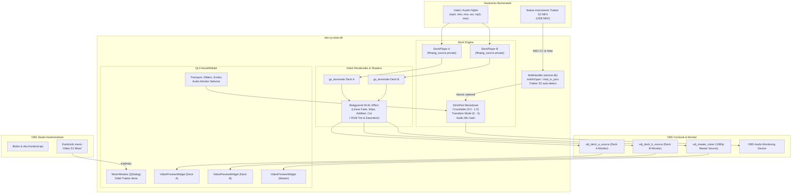

# PROJEKT RESET & MESTERTERV: OBS VIDEO DJ (VJ) MIXER PLUGIN

Ez a dokumentum a projekt teljes kontextusát, forrásfájljait, hardveres illesztését, rendszerarchitektúráját és aktuális fejlesztési állapotát rögzíti. Bármikor bemásolható új munkamenet indításakor az azonnali folytatáshoz.

---

## 1. ALAPADATOK ÉS CÉLKITŰZÉS
* **Projekt neve / Repó:** `amagbigger-dotcom/obs_vj-dj_plugin`
* **Kimeneti könyvtár / bináris:** `obs-vj-mixer.dll`
* **Cél:** Natív C++17 (Qt 6) OBS Studio bővítmény (Windows x64, OBS 30+/33+), amely 2 deckes professzionális Video DJ keverőként üzemel.
* **Telepítési forma:** Kizárólag **1 darab `obs-vj-mixer.dll`** fájl, amely közvetlenül a `C:\Program Files\obs-studio\obs-plugins\64bit\` mappába másolható. Nincsenek külső `.effect` fájlok vagy segédmappák; az összes HLSL shader C++ karaktersorozatként be van ágyazva a binárisba.
* **Hardveres vezérlő:** **Native Instruments TRAKTOR KONTROL S2 MK3** USB MIDI módban.

---

## 2. A HÁROM REFERENCIA-PILLÉR
1. **Exeldro OBS Architektúra (`obs-media-controls`, `obs-shaderfilter`):**
   - Nem OBS dock panelként épül be, hanem önálló lebegő dialógusként (`QDialog` / `Qt::Window`), ami az OBS felső **Eszközök (Tools) $\rightarrow$ Video DJ Mixer** menüjéből nyitható meg, elkerülve az OBS dokkoló felületének szétesését.
   - Beágyazott HLSL shader C++ karaktersorozatként a binárisban (`gs_effect_create`), így nem igényel külső fájlokat a működéshez.
   - Kétcsatornás textúra-renderelő pipeline (`gs_texrender`) a Deck A és Deck B képének valós idejű Direct3D / OpenGL összefűzéséhez.
   - Privát médiaforrások kezelése (`obs_source_create_private("ffmpeg_source", ...)`).
2. **DJ Sugar / Mixxx Lejátszási Motor:**
   - Kétcsatornás állapotgép: Play/Pause toggle, CUE pont rögzítés és visszaugrás, varratmentes Auto-Loop (1/2 – 64 ütem), pozíciókövetés és időkódlekérés (ms pontosság).
   - Sebesség / Pitch fader kezelés (50% – 150% tartomány).
   - Sync gomb (tempóátvétel a másik deckről oda-vissza).
3. **Traktor Kontrol S2 MK3 Hardver és Vizuális EQ:**
   - 3 sávos EQ és Filter leképzése valós idejű képi paraméterekre:
     * **HI Knob:** PIROS (Red) csatorna szorzója (0.0f – 2.0f, alap: 1.0f).
     * **MID Knob:** ZÖLD (Green) csatorna szorzója (0.0f – 2.0f, alap: 1.0f).
     * **LOW Knob:** KÉK (Blue) csatorna szorzója (0.0f – 2.0f, alap: 1.0f).
     * **FILTER:** SZATURÁCIÓ (Rec.709 Luma alapú: 0.0f = fekete-fehér, 1.0f = natív, 2.0f = túltelített).
   - Csatornánkénti hangerőféderek és központi nagyméretű Master Crossfader (hang és kép egyidejű keverésével).

---

## 3. RENDSZERARCHITEKTÚRA ÉS ADATÁRAMLÁS

### 3.1. Blokkvázlat


### 3.2. Szálkezelési modell és Thread-Safety
A bővítmény három független szálon/környezetben dolgozik:
1. **OBS Render Thread (Graphics Loop):**
   - Itt fut a `mixer_video_render` és a `monitor_video_render`.
   - `obs_enter_graphics()` / `obs_leave_graphics()` védelem a textúrák és display-ek készítésekor.
   - Nem végezhet blokkoló műveletet; az értékeket közvetlenül az atomi változókból olvassa.
2. **WinMM MIDI Callback Szál (`midi_in_proc`):**
   - Aszinkron érkező hardveres megszakítás Windows Multimedia szinten.
   - Kizárólag szálbiztos `std::atomic` műveleteket végez a `DeckPlayer` és `DeckPair` paraméterein (`setRed`, `setGreen`, `setBlue`, `setSaturation`, `setVolume`, `setSpeed`, `setCrossfader`).
   - Nem hívhat közvetlen Qt GUI metódusokat (GUI szál crash elkerülése miatt).
3. **Qt GUI Eseményhurok (Main Thread):**
   - Felhasználói egér- és gombesemények (`MixerWindow`).
   - 80 ms-os `QTimer` gondoskodik a pozíciók, időkódok, gombfeliratok és MIDI kapcsolat állapotának lekérdezéséről és frissítéséről (`refreshDeck`, `refreshMixer`).

---

## 4. TRAKTOR KONTROL S2 MK3 MIDI KIOSZTÁS

| Kezelőszerv | Esemény típusa | MIDI Csatorna & Paraméter | Plugin Funkció | Skálázás / Matematika |
| :--- | :--- | :--- | :--- | :--- |
| **Deck A HI** | Control Change | Ch 1, CC 16 (0–127) | Deck A Vörös (Red) EQ | `val / 63.5f` $\rightarrow$ $0.0 - 2.0$ (közép: 1.0) |
| **Deck A MID** | Control Change | Ch 1, CC 17 (0–127) | Deck A Zöld (Green) EQ | `val / 63.5f` $\rightarrow$ $0.0 - 2.0$ (közép: 1.0) |
| **Deck A LOW** | Control Change | Ch 1, CC 18 (0–127) | Deck A Kék (Blue) EQ | `val / 63.5f` $\rightarrow$ $0.0 - 2.0$ (közép: 1.0) |
| **Deck A FILTER** | Control Change | Ch 1, CC 19 (0–127) | Deck A Szaturáció | `val / 63.5f` $\rightarrow$ $0.0 - 2.0$ (közép: 1.0) |
| **Deck A VOL FADER**| Control Change | Ch 1, CC 20 (0–127) | Deck A Hangerő | `val / 127.0f` $\rightarrow$ $0.0 - 1.0$ |
| **Deck A TEMPO** | Control Change | Ch 1, CC 21 (0–127) | Deck A Sebesség (Pitch) | $50 + (val \times 100) / 127$ $\rightarrow$ $50\% - 150\%$ |
| **Deck A PLAY** | Note On ($vel > 0$) | Ch 1, Note 35 | Deck A Play / Pause toggle | Állapotfüggő váltás |
| **Deck A CUE** | Note On ($vel > 0$) | Ch 1, Note 36 | Deck A CUE mentés / ugrás | Lejátszáskor: ugrás + pause; Stopkor: CUE mentés |
| **Deck A SYNC** | Note On ($vel > 0$) | Ch 1, Note 37 | Deck A Sync Deck B-hez | Deck A sebességének beállítása Deck B sebességére |
| **Deck B HI** | Control Change | Ch 2, CC 16 (0–127) | Deck B Vörös (Red) EQ | `val / 63.5f` $\rightarrow$ $0.0 - 2.0$ (közép: 1.0) |
| **Deck B MID** | Control Change | Ch 2, CC 17 (0–127) | Deck B Zöld (Green) EQ | `val / 63.5f` $\rightarrow$ $0.0 - 2.0$ (közép: 1.0) |
| **Deck B LOW** | Control Change | Ch 2, CC 18 (0–127) | Deck B Kék (Blue) EQ | `val / 63.5f` $\rightarrow$ $0.0 - 2.0$ (közép: 1.0) |
| **Deck B FILTER** | Control Change | Ch 2, CC 19 (0–127) | Deck B Szaturáció | `val / 63.5f` $\rightarrow$ $0.0 - 2.0$ (közép: 1.0) |
| **Deck B VOL FADER**| Control Change | Ch 2, CC 20 (0–127) | Deck B Hangerő | `val / 127.0f` $\rightarrow$ $0.0 - 1.0$ |
| **Deck B TEMPO** | Control Change | Ch 2, CC 21 (0–127) | Deck B Sebesség (Pitch) | $50 + (val \times 100) / 127$ $\rightarrow$ $50\% - 150\%$ |
| **Deck B PLAY** | Note On ($vel > 0$) | Ch 2, Note 35 | Deck B Play / Pause toggle | Állapotfüggő váltás |
| **Deck B CUE** | Note On ($vel > 0$) | Ch 2, Note 36 | Deck B CUE mentés / ugrás | Lejátszáskor: ugrás + pause; Stopkor: CUE mentés |
| **Deck B SYNC** | Note On ($vel > 0$) | Ch 2, Note 37 | Deck B Sync Deck A-hoz | Deck B sebességének beállítása Deck A sebességére |
| **CROSSFADER** | Control Change | Global / Ch 1, CC 8 (0–127) | Master Crossfader | `val / 127.0` $\rightarrow$ $0.0$ (A) és $1.0$ (B) között |

*Megjegyzés:* A Traktor S2-n a Note On 0 velocity értékét a Windows MIDI Note Off-ként kezeli; a gombesemények csak valós lenyomáskor ($vel > 0$) váltanak ki akciót.

---

## 5. FORRÁSFAJLOK ÉS AKTUÁLIS ÁLLAPOTUK

* **`CMakeLists.txt`:** *(Kész)*
  - CMake 3.25+, C++17, Qt6 (Core, Gui, Widgets), libobs, obs-frontend-api.
  - A `winmm` és Windows Media Foundation (`mfplat`, `mfreadwrite`, `mfuuid`, `propsys`) könyvtárak hozzáadva a `target_link_libraries`-hez.
  - Generált célpont: `obs-vj-mixer.dll`.
* **`src/audio-analyzer.hpp` & `src/audio-analyzer.cpp`:** *(Kész)*
  - `AudioAnalyzer`: Aszinkron audio dekódolás (Windows Media Foundation SourceReader) háttérszálon.
  - Valós hullámforma envelope számítás (600 csúcsérték bucket).
  - Onset novelty curve energianövekmény és autokorrelációs valódi BPM detektálás (60–190 BPM tartomány, 125 BPM prior).
  - Downbeat (Kick 1) leütés-detektálás a rács első taktusvonalának automatikus igazításához.
* **`src/waveform-widget.hpp` & `src/waveform-widget.cpp`:** *(Kész)*
  - Traktor DJ Studio 2 stílusú kétrétegű kompakt widget:
    - Felső részletes gördülő hullámforma valós audio csúcsokkal, ütemrácssal, számozott taktusvonalakkal és lejátszófejjel.
    - Alsó arany áttekintő csík a teljes track hangerejével és loop kijelzéssel.
    - DISP fejléc: Fájlnév, eltelt/hátralévő idő, dinamikus BPM és `[edit]` gomb azonnali pontos kézi beíráshoz.
    - Jobb gombos húzás az ütemrács valós idejű csúsztatásához.
* **`src/mixer-dock.hpp` & `src/mixer-dock.cpp`:** *(Kész)*
  - Traktor DJ Studio 2 stílusú 3 oszlopos professzionális felület (`Deck A | Mixer | Deck B`):
    - `DJSlider` potméterek dupla kattintásos azonnali reset funkcióval (0 dB / 100% / 50% center).
    - `MOVE` szekció: `<<`, `SET 1`, `>>` gombok az ütemrács okamnali tolásához és az 1. ütem rögzítéséhez.
    - `LOOP` mátrix (`1/2, 1, 2, 4, 8, 16, 32`) narancssárga aktív világítással.
    - `TRANSPORT` szekció: `CUE ||`, `SET`, `CUE ▶`, és megvilágított sárga `PLAY` gomb.
    - Kettős Hangkártya választó a fejlécben: Master Soundcard és Füles (Headphone / CUE).
    - `[ 📺 ADD TO SCENE ]` gomb a VJ Master forrás azonnali jelenetbe helyezéséhez.
* **`src/deck-engine.hpp` & `src/deck-engine.cpp`:** *(Kész)*
  - `DeckPlayer`: Privát `ffmpeg_source` kezelő. Támogatja a Play/Pause, CUE, seek, sebesség (50-150%), hangerő, atomi RGB és telítettségi értékek, BPM és kvantált ütemhelyes beat loop (1/2, 1, 2, 4, 8, 16, 32, 64 ütem) futtatását.
  - Tempóváltás pozíció-megőrzéssel (`pending_speed_seek_ms_`), amely megakadályozza, hogy a videó a legelejére ugorjon sebességállításkor.
  - Fejhallgató CUE (PFL) állapotkezelés és Pre-Fade hangerővezérlés.
  - `DeckPair`: Deck A és B párosítása, mester forrás (`vdj_master_mixer`) összerendelése, crossfader és átmeneti módok kezelése, tempószinkron (`syncTempoAtoB`, `syncTempoBtoA`), OBS aktív kimenet választó (`obs_output_mode_`), fejhallgató hangerő és Cue/Master mix.
* **`src/mixer-source.cpp`:** *(Kész)*
  - Kettős `gs_texrender` renderelési lánc.
  - Beágyazott `MIXER_EFFECT` HLSL shader:
    - RGB szorzók (`gains_a`, `gains_b`) és Rec.709 luma alapú színtelítettség (`saturation_a`, `saturation_b`).
    - 4 átmeneti mód: 0 = Linear Fade, 1 = Horizontal Wipe, 2 = Additive Blend, 3 = Hard Cut.
  - OBS kimeneti mód választó támogatása: Master Crossfade (0), Direkt Deck A (1), Direkt Deck B (2).
  - OBS források regisztrációja: `vdj_master_mixer` (mester kimenet), `vdj_deck_a_source` és `vdj_deck_b_source` (egyedi monitorok) `enum_active_sources` és `enum_all_sources` támogatással.
* **`src/shaders/crossfade.effect`:** *(Kész)*
  - Referencia HLSL effect fájl külső teszteléshez és későbbi kibővítésekhez.
* **`src/midi-handler.hpp` & `src/midi-handler.cpp`:** *(Kész)*
  - Windows Multimedia API alapú MIDI illesztő (`midiInOpen`, `midiInStart`, `midiInStop`, `midiInClose`).
  - Automatikus kontroller-keresés: név alapján detektálja a "traktor" és "s2" sztringeket a csatlakoztatott MIDI bemenetek között.
  - Feldolgozza a CC 8, 16–21 és Note 35–38 üzeneteket (Play, Cue, Sync, Headphone Cue), és közvetlenül a `DeckPair` / `DeckPlayer` atomi változóiba írja.
* **`src/mixer-dock.hpp` & `src/mixer-dock.cpp`:** *(Kész)*
  - Traktor Pro stílusú professzionális sötét kezelőfelület:
    - A kis videó előnézetek helyett interaktív zenei `WaveformWidget` hullámforma és BPM sávok.
    - **OBS ACTIVE OUTPUT** gombok: `[ MASTER MIX ]` | `[ DECK A ]` | `[ DECK B ]`, amelyek közvetlenül a fő OBS vászonra küldik a választott forrást.
    - Fejhallgató CUE (PFL) gombok mindkét deckhez (`[ 🎧 CUE A ]`, `[ 🎧 CUE B ]`).
    - Fejhallgató Cue/Master Mix és Hangerő szabályozók.
    - Kétcsatornás EQ és Volume fader szekció, nagyméretű Master Crossfader.
    - Hangkártya választó és automatikus inicializálás (`obs_enum_audio_monitoring_devices`).
  - 50 ms-os frissítési ciklus (`QTimer`).

---

## 6. FEJLESZTÉSI EREDMÉNYEK ÉS HÁTRALÉVŐ LÉPÉSEK (BACKLOG)

### 1. Kétirányú GUI $\leftrightarrow$ Deck szinkronizáció *(KÉSZ)*
- A kezelőfelületen lévő `HI`, `MID`, `LOW`, `FILTER` csúszkák `valueChanged` eseményei rákötve a `setRed()`, `setGreen()`, `setBlue()`, `setSaturation()` hívásokra ($1.0 + val / 100.0f$).
- A `refreshDeck` ciklus `QSignalBlocker`-rel és `!isSliderDown()` védelemmel lekérdezi és simán animálja az EQ és Volume csúszkákat a Traktor S2 hardveres potmétereinek forgatásakor.
- A Master Crossfader és a Pitch slider szintén védve van a visszaugrásoktól (`!isSliderDown()`).

### 2. Valós BPM kezelés, Tap Tempo és Ütemvonalak *(KÉSZ)*
* **Megvalósítás:** A `WaveformWidget` valós idejű digitális BPM kijelzést, TAP Tempo számlálót, `+`/`-` finomhangolást és gördülő beatgrid ütemvonalakat kapott. Az Auto-Loop a valós BPM és sebesség alapján kvantált ütemhelyes loopolást végez.

### 3. Tempóállítás pozíció-megőrzéssel *(KÉSZ)*
* **Megvalósítás:** A sebesség csúszka mozgatásakor az aktuális lejátszási pozíció rögzítésre kerül, így a dekóder újraindulásakor nem ugrik a videó a legelejére.

### 4. Fejhallgató Előhallgatás (Headphone CUE / PFL) *(KÉSZ)*
* **Megvalósítás:** Külön CUE A és CUE B előhallgatási gombok, független Pre-Fade jelszint kezelés és fejhallgató hangerő / Cue-Master mix potméter.

### 5. OBS Aktív Kimenet Választó *(KÉSZ)*
* **Megvalósítás:** A felületről közvetlenül vezérelhető, hogy az OBS fő kimenetén a Master Mix, csak a Deck A vagy csak a Deck B jelenjen meg.

### 6. Valós BPM Analízis, Kick Transient Detektálás & Hullámforma *(KÉSZ)*
- Az `AudioAnalyzer` 44.1 kHz-es mono WMF dekódolással (dinamikus 16/32-bit float fallbackkel) és 160 Hz-es másodrendű aluláteresztő szűrővel elkülöníti a lábdob energiát.
- 500 Hz-es (2 ms) felbontású Onset Novelty görbe és autokorreláció 3 pontos parabolikus interpolációval (0.05 BPM pontosság) és automatikus downbeat (Kick 1) ütemrács-igazítás.
- Globális normalizált tranzienstelítés: a hullámforma a kickszel 0.95–1.0 csúcsokat üt ki, a völgyekben pedig 0.15–0.25-re esik vissza, megszüntetve a lapos téglalap-telítettséget.

### 7. OBS Videó Renderelés & 1080p GPU DJ Vizualizáció *(KÉSZ)*
- A `MIXER_EFFECT` HLSL shader `mul(v.pos, ViewProj)` projekcióval tűpontosan illeszkedik az OBS jelenet koordinátarendszerébe.
- Valós videófájloknál (.mp4, .mov) a dekódolt videó jelenik meg valós idejű színkorrekcióval és 4-féle átmeneti móddal (Linear Fade, Wipe, Additive, Cut).
- Tisztán audió fájloknál (.wav, .mp3) a shader egy 1080p 60 FPS sebességű procedurális DJ stúdió vizualizációt generál a GPU-n: percenkénti fordulatszámmal (BPM) forgó analóg vinyl lemez, neonszínű horizontális kiber grid, kivezérlésjelző frekvenciasávok és deck-színű világító fénygyűrű.

### 8. Audió Útvonalválasztás és 3-sávos DSP Szűrés *(KÉSZ)*
- A privát dekóder forrás `OBS_MONITORING_TYPE_MONITOR_AND_OUTPUT` módban dolgozik natív OBS audio filterrel (`vdj_eq_filter`).
- A 3-sávos EQ és DJ Filter valós időben közvetlenül a mintákra fut le csatornánként.
- A Master Crossfader, hangerő és Pre-Fade CUE jelszintek tisztán és akadásmentesen jutnak el az OBS kimenetre és a fejhallgató monitorra.

### 9. Varratmentes Ütemhelyes Beat Loop *(KÉSZ)*
- Eltávolítva a nulla időtartamú blokkolás; az Auto-Loop (1/2 – 32 ütem) bármely pillanatban azonnal aktiválható.
- Kettős állapotgép-ellenőrzés: 50 ms-os Qt GUI ciklusban és a renderelési ciklusban is lefut 40 ms-os debounce védelemmel, megakadályozva a visszaugrás átcsúszását vagy ffmpeg túlterhelését.

### 10. Interaktív Ütemrács (Beatgrid) Csúsztatás és Duplaklikkes Reset *(KÉSZ)*
- `Shift + Bal egérgombos húzás` VAGY `Jobb egérgombos húzás` a hullámformán az ütemrács (Beatgrid) azonnali valós idejű eltolásához.
- A `MOVE` szekcióban `<<` és `>>` finomhangoló gombok (10 ms) és valós idejű `GRID: Xms` kijelzés.
- Minden EQ, Gain, Filter és Pitch potméter dupla kattintásra visszaugrik az alapértelmezett középpozícióba.

### 11. Teljes Számanalízis és Oldalkocsi Leíró Fájl (`.vdj.json`) *(KÉSZ)*
- A 240 mp-es korlát feloldva: a sáv teljes hosszát analizálja.
- Első betöltéskor közvetlenül a médiafájl mellé lement egy kompakt `<fajl>.vdj.json` gyorsítótárat (BPM, downbeat eltolás, CUE pont, overview és részletes hullámforma csúcsok).
- Ismételt betöltéskor 1 ms alatt, 0% CPU terheléssel tölti be az adatokat.
- Felhasználói beállítások (kézi BPM editálás, `SET 1` vagy `<<`/`>>` rácsoltás, új CUE pont) automatikusan beleíródnak a JSON leíróba és megmaradnak a következő indításra.

### 12. Kétirányú MIDI Clock & Központi Master Architektúra *(KÉSZ)*
- **EXT SYNC (Bejövő MIDI órajel):** `0xF8` Tick és 24 PPQN számlálás, valós idejű BPM kalkuláció és szinkronizáció külső DAW-hoz / hardver szintetizátorhoz.
- **SEND CLOCK (Kimenő MIDI órajel):** Független mikroszekundumos háttérszálon futó MIDI Clock (`0xF8`) generátor 24 PPQN sebességgel külső hardverek vagy fényvezérlők hajtásához.

### 13. OBS Videó Vászon Renderelés és Akadozásmentes Lejátszás *(KÉSZ)*
- **100% Opak Alpha és Direkt Blend:** A `MIXER_EFFECT` HLSL shader `colorize` és `PS` metódusa explicit `color.a = 1.0` és `res.a = 1.0` értéket garantál. A renderelési textúra törlése opaque feketével (`{0, 0, 0, 1}`) történik.
- **`gs_blend_function(GS_BLEND_ONE, GS_BLEND_ZERO)`:** Mind az offscreen textúra felvételénél, mind a végső vászon sprite kirajzolásánál bekapcsolva a közvetlen felülíró blend mód, így a videó képe sosem válik transzparenssé vagy láthatatlanná.
- **Gyermek Forrás Pumpálás (`video_tick`):** A `vdj_master_mixer` és a monitor források megkapták a natív `.video_tick` callbacket, amely minden képkockán meghívja az `obs_source_video_tick`-et a privát dekóder forrásokra, garantálva az aszinkron képkockák folyamatos dekódolását és szinkronizálását.
- **Akadásmentes Lejátszás & Audio Puffer Védelem:**
  - A 60 FPS-es ciklusban futó ismételt `obs_source_media_set_time` seek hívások megszüntetve; a seek ugrás kizárólag egyszer fut le, megelőzve az FFmpeg dekóder lefulladását.
  - A fejhallgató CUE audiocsatorna (`queueCueAudio`) inaktív állapotban nulla adatot küld az OBS monitor forrásnak, így nem aktiválódik az OBS audio deduplikáció és puffer-késleltetés (`adding 64 milliseconds of audio buffering`).
- **Névadás & Branding:** A felület, ablak és források hivatalos neve: **OBS VJ/DJ Plugin** és **OBS VJ/DJ Mixer**.

### 14. Moduláris Standalone VJ Deck Architektúra (Build #190) *(KÉSZ)*
- **Független Deck Koncepció:** A Deck kizárólag lejátszóként funkcionál, független attól, hogy melyik mixer-oldalra lesz majd bekötve.
- **Közvetlen Vászon Renderelés (`vj_deck`):** Szabványos `OBS_SOURCE_VIDEO` forrás, amely `obs_source_video_render(media)` hívással azonnal és akadálytalanul kirajzolja a dekódolt videóképet a fő OBS vászonra (nincsenek texrender vagy shader köztes rétegek).
- **Gyermek Forrás Kezelés:** `enum_active_sources` és `enum_all_sources` bekötve az audio és aktív állapotokhoz; `OBS_MONITORING_TYPE_MONITOR_AND_OUTPUT` biztosítja a monitorozást.
- **Akadásmentes Tempó / Pitch Fader:** A sebességcsúszka mozgatásakor nem hívódik folyamatosan a dekóder újraindítása, csak a felengedéskor (`sliderReleased`), a pozíció-megőrző logika pedig elkerüli a 0 ms-ra való visszaugrást.
- **Önálló GUI Ablak (`DeckWindow`):** Dedikált lebegő dialógus a `Eszközök -> OBS VJ Deck` menüből teljes WaveformWidgettel, Beatgrid szerkesztővel (`<<`, `SET 1`, `>>`, `TAP`), Auto-Loop mátrixszal, és Transport gombokkal.

### 15. Valós Idejű Élő Tempó, Hullámforma és Hangkeverő Javítások (Build #192) *(KÉSZ)*
- **Folyamatos Gördülő Hullámforma:** Az `onRefresh()` időzítő minden 50 ms-ban frissíti a `WaveformCanvas`-t, így a lábdob tranziensek, ütemvonalak és a lejátszófej akadásmentesen és élőben gördülnek.
- **Tiszta Egyrétegű Felület:** A duplikált "Empty Deck - Click Load" fejléc eltávolítva, a hullámforma közvetlenül jelenik meg teljes magasságban.
- **Helyben Szerkeszthető BPM Mező:** Felugró ablakok nélkül közvetlenül a mezőre kattintva átírható a BPM (`QLineEdit` és Enter lenyomás).
- **Vonalszintű Kalibrált Hangerő:** Megszüntetve a belső forrás párhuzamos direkt monitorozása; a hangerő 100%-nál is maximum 1.0f (0 dB vonalszint), az alapértelmezett érték 80% (tiszta vonalszint).
- **Natív OBS Hangkeverő Integráció:** `output_flags = OBS_SOURCE_VIDEO | OBS_SOURCE_AUDIO | OBS_SOURCE_DO_NOT_DUPLICATE`, így az `OBS VJ Deck` megjelenik az OBS Hangkeverőjében.
- **Folyamatos Élő Tempóállítás:** 80 ms-os folyamatos ütemező mozgatás közben, azonnal hallható zenei gyorsulással/lassulással, NVDEC GPU hardveres dekódolással (`hw_decode = true`) és Auto-Loop seek debounce védelemmel.

### 16. Audió Forwarding, Automatikus 1080p GPU Méretezés, Pozícióbiztos Tempó és Szélesebb Waveform (Build #193) *(KÉSZ)*
- **Natív Audió Forwarding & Hangkeverő:** A `vj_deck` forrás `obs_source_add_audio_capture_callback` segítségével valós időben közvetíti a privát dekóder audió mintáit az OBS-nek (`obs_source_output_audio`). A forrás alapértelmezetten mind a 6 sávra hozzá van rendelve (`0x3F`), a monitorozás aktív (`MONITOR_AND_OUTPUT`), így a hangerőmérő ugrál és megszűnt a "Nem hozzárendelt hangforrás" figyelmeztetés.
- **Automatikus 1080p GPU Méretezés:** A `deck_get_width` és `deck_get_height` fixen 1920x1080 felbontást ad vissza. A `deck_video_render` a forrás valós felbontásától függetlenül (720p, 1080p, 1440p, 4K) `gs_matrix_scale3f(1920/sw, 1080/sh, 1)` mátrix transzformációval automatikusan kitölti a standard vásznat. Nincs többé szükség kézi átméretezésre vagy jelenet-transzformációra.
- **Pozícióbiztos Kétfázisú Tempóváltás:** A sebesség változtatásakor a lejátszási pozíció nem ugrik a szám elejére (0:00). A rendszer megvárja, míg az FFmpeg dekóder újraindulása után a pozíció 0 közelébe esik, és azonnal visszaugrik a mentett pozícióra. A csúszka mozgatása 250 ms-os védelemmel van ellátva az FFmpeg túlterhelés elkerülésére.
- **Kompakt, Letisztult Időkijelzés:** A két óriási, feleslegesen nagy 20px-es doboz helyett egységes, professzionális és helytakarékos 13px-es időkijelző sáv (`TIME 00:00.00 | REMAIN -00:00.00`).
- **Magasabb, 32px-es Teljes Számanalízis Csík:** Az overview csík magassága megduplázódott (16px -> 32px), gazdag borostyán/arany hullámformával, kiemelt tranziensekkel és dropokkal, így a teljes zene felépítése azonnal áttekinthető és pontosan pozícionálható.
- **Állítható Waveform Zoom és Természetes Sebesség:** A látható időtartam alapértelmezetten 3 másodpercről 6 másodpercre duplázódott (fele akkora látszólagos gördülési sebesség). A felületen `[−]` és `[+]` gombokkal, illetve közvetlenül az egérgörgővel fokozatmentesen zoomolható a gördülő hullámforma (2s - 16s tartományban).

### 17. Dinamikus Hullámforma Illesztés, Tempó Pozícióvédelem és Automatikus Sáv-Hozzárendelés (Build #197) *(KÉSZ)*
- **Dinamikus Hullámforma Mintavételezés:** A korábbi fix 10 ms-os indexelés helyett a `detailed_peaks` tömb méretéhez dinamikusan illeszkedő skálázás (`duration / detailed.size()`). Megszűnt az a hiba, hogy a szám felénél a gördülő hullámforma egyenes vonallá laposodott; most a teljes szám hosszában gazdag, élő csúcsok és völgyek láthatók bármely zoom szinten.
- **Tempóváltás Pozíció-felülírás Elleni Védelme:** A csúszka mozgatása közbeni többszöri újraindulás kizárva: a rendszer csak akkor rögzít új seek pozíciót, ha épp nincs folyamatban lévő dekóder újraindítás, megelőzve a 0:08 körüli téves időkódok mentését. A sebességmódosítás 350 ms-os intelligens szünet/felengedés védelemmel stabilan egyetlen seekkel ugrik a pontos helyre.
- **Automatikus Sáv- és Monitorozás Kényszerítés:** A `deck_video_tick` ellenőrzi az OBS forrás audio mixer sávjait. Ha az OBS korábbi mentésből 0 sávot töltött be (ez okozta a *"Nem hozzárendelt"* feliratot és a sárga felkiáltójelet), azonnal bekapcsolja mind a 6 sávot (`0x3F`) és a `MONITOR_AND_OUTPUT` módot, így a szintmérő azonnal életre kel.
- **[ ⛶ FIT 1080p ] Vászonhoz Igazítás Gomb:** A felső sávba beépített azonnali gomb, amely a jelenetben található `OBS VJ Deck` forrást egyetlen kattintással (0, 0) pozícióra és 1.0 méretarányra állítja, kitöltve a teljes 1080p vásznat.

### 18. GPU Frame Freeze, Deck A/B Routing és Integrált Tracklist Panel (Build #198) *(KÉSZ)*
- **GPU Frame Freeze (0:00 felvillanás kizárása):** A `deck-source.cpp` egy offscreen `gs_texrender` rétegen keresztül rendereli a videót. Amikor a tempócsúszka mozgatásakor az OBS `ffmpeg_source` újraindul (`speed_restart_phase_ != 0`), a plugin kimerevíti az utolsó érvényes videótextúrát a GPU-n. Az FFmpeg által az újranyitáskor generált 0:00-s képkocka **soha nem kerül a pufferbe és a vászonra**, így a sebességváltás vizuális villanás nélkül, simán folytatódik a visszaugrás után.
- **Kezelőfelület Letisztítása & Hangerőcsúszka Törlése:** A felesleges, nem funkcionáló belső hangerőcsúszka eltávolítva a Deck felületről. A Deck tiszta 1.0f (0 dB vonalszint) jelet ad az OBS-nek és a leendő mixernek.
- **DECK A és DECK B Kapcsolópár:** A korábbi nagy FIT gomb helyére egy elegáns `[ DECK A ]` (kék) és `[ DECK B ]` (narancssárga) kapcsoló került. A felhasználó egyetlen kattintással átkapcsolhatja a vezérlőfelületet a Deck A és Deck B között, miközben az 1080p vászonhoz illesztés automatikusan és észrevétlenül lefut a háttérben.
- **Integrált OBS VJ Tracklist Panel (Médiatár & Konverter):**
  - Önálló ablak az `Eszközök -> OBS VJ Tracklist` menüből, illetve a Deck ablak `[ 📋 TRACKLIST ]` gombjából.
  - **Drag & Drop Importálás:** Tetszőleges MP4/MKV/MOV videók behúzása a felületre.
  - **Hardveres RTX 3060 NVENC 1080p All-Intra Konvertálás:** A háttérben az NVIDIA GPU-val 3-5 másodperc alatt 1080p All-Intra (`-g 1`) formátumra alakítja a videókat a felhasználó VJ mappájába (`Videos/VJ_Clips`).
  - **Azonnali Automata BPM & Hullámforma Analízis:** A konvertálás után azonnal legenerálja a `.vdj.json` gyorsítótárat.
  - **Perzisztens Lista & Lejátszási Állapot (✓):** A lista megőrzi az elemeket az OBS újraindításakor. A sorokból közvetlen `[ LOAD A ]` és `[ LOAD B ]` gombokkal azonnal betölthető a szám, és a lejátszott tételek mellett megjelenik a zöld `✓` (pipa) jelzés, vagy a futó `▶ A` / `▶ B` státusz.

### 19. Automatikus Formátumfelismerés, NVENC Hibajavítás, Törlés és Egységes Import (Build #199) *(KÉSZ)*
- **NVENC Paraméter Hibajavítás & Biztos Elindulás:** Az NVIDIA NVENC enkóder hibára futott (`Gop Length should be greater than number of B frames + 1`), mert a `-g 1` opció ütközött az alapértelmezett B-framekkel. Javítva: `-g 2 -bf 0 -rc vbr -cq 18 -b:v 0`, amellyel az RTX 3060 90+ FPS sebességgel, hibátlan 1080p All-Intra minőségben azonnal végrehajtja a konvertálást.
- **Többszintű FFmpeg Útvonalkeresés:** A `findFfmpegBinary()` mostantól ellenőrzi az OBS `bin/64bit`, `%APPDATA%/obs-studio/plugin_config/obs-vj-mixer`, és `C:/Program Files/obs-studio/bin/64bit` könyvtárakat, és a `process_->errorOccurred` azonnali CPU fallbackkel megakadályozza a `Conv 0%`-on való beragadást.
- **Okos Automata Formátumfelismerés:** Megszüntetve a különálló direkt gomb. Egyetlen `[ + IMPORT MEDIA ]` gomb és Drag & Drop működik:
  - Ha audiófájl (`mp3`, `wav`, `flac`, `aac`): nem konvertálja videóként, azonnal betölti és analizálja.
  - Ha már 1080p All-Intra vagy létezik `_vj1080.mp4` a VJ mappában: azonnal újrahasznosítja, nincs felesleges újra-kódolás.
  - Ha új videó: azonnal elindítja a háttérben az NVENC 1080p konvertálást.
- **Track Törlés Megerősítéssel (Delete gomb & Jobb klikk):** Bármely kijelölt dal törölhető a Delete gombbal, a felső sáv `[ 🗑 TÖRLÉS ]` gombjával vagy a jobb egérgombos menüből, megerősítő kérdés után (`QMessageBox`).
- **Deck "OPEN MEDIA" bekötése a Tracklist csővezetékbe:** A Deck felületén az "OPEN MEDIA" gombra kattintva a kiválasztott videó automatikusan a Tracklist csővezetékébe kerül, konvertálódik (ha szükséges), és azonnal betöltődik a választott Deckbe (Deck A vagy B).

---

## 7. ÉPÍTÉSI ÉS TELEPÍTÉSI ÚTMUTATÓ

### 7.1. Helyi fordítás (Windows 10/11 x64)
Előfeltételek:
* Visual Studio 2022 (MSVC v143 C++ eszközök)
* CMake 3.25 vagy újabb
* Qt 6.6+ (MSVC 2022 x64 build)
* Előre lefordított OBS Studio 33+ SDK (fejlécek és `.lib` könyvtárak)

Parancsok:
```powershell
# Környezeti változó beállítása az OBS SDK helyére:
$env:OBS_SDK_DIR = "C:\path\to\obs-studio-sdk"

# CMake konfigurálás
cmake -S . -B build -A x64 "-DOBS_SDK_DIR=$env:OBS_SDK_DIR"

# Fordítás Release módban
cmake --build build --config Release --parallel
```

### 7.2. Telepítés
1. A sikeres fordítás után a `build\Release\obs-vj-mixer.dll` fájl jön létre.
2. Zárja be az OBS Studio-t.
3. Másolja be a fájlt az OBS bővítmény mappájába:
   `C:\Program Files\obs-studio\obs-plugins\64bit\obs-vj-mixer.dll`
4. Indítsa el az OBS-t, és nyissa meg a keverőt az **Eszközök (Tools) $\rightarrow$ Video DJ Mixer** menüpontból.
