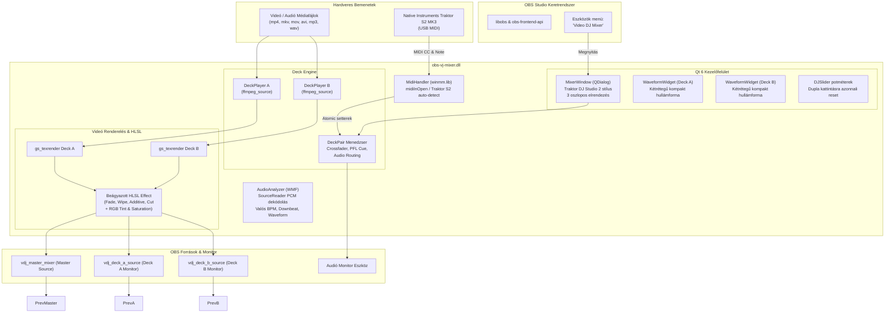

# OBS Video DJ (VJ) Mixer Plugin

[](https://github.com/amagbigger-dotcom/obs_vj-dj_plugin/actions/workflows/build.yml)


> Professzionális 2-deckes Video DJ (VJ) keverő bővítmény az **OBS Studio** számára, natív **C++17 / Qt 6** alapokon, közvetlen **Native Instruments TRAKTOR KONTROL S2 MK3** USB MIDI hardvertámogatással és beágyazott HLSL videó-shaderekkel.

---

## 1. Főbb Jellemzők

* **Egyetlen önálló bináris (`obs-vj-mixer.dll`):** Nincsenek külső `.effect` fájlok, szkriptek vagy segédmappák; az összes HLSL shader C++ karaktersorozatként be van ágyazva a DLL-be.
* **Lebegő Traktor stílusú kezelőfelület:** Nem töri szét az OBS beépített dokkoló elrendezését; az OBS felső menüjéből (*Eszközök* $\rightarrow$ *Video DJ Mixer*) nyitható meg lebegő ablak formájában (`QDialog`).
* **Valós idejű zenei hullámforma és BPM kijelzés (`WaveformWidget`):** Digitális BPM kijelző, `TAP` tempó gomb, görgetett audio-hullámforma és függőleges beatgrid ütemvonalak minden negyed- és egész ütemnél, az aktuális lejátszási fejjel.
* **OBS Főablak Kimenetválasztó (OBS Active Output):** `[ MASTER MIX ]` | `[ DECK A ]` | `[ DECK B ]` gombokkal közvetlenül a felületről vezérelhető, hogy mi jelenjen meg az OBS vásznon és stream kimeneten.
* **Fejhallgató Előhallgatás (Headphone CUE / PFL):** Csatornánkénti `[ 🎧 CUE ]` gombok, külön Pre-Fade jelszint kezelés, fejhallgató hangerő és Cue/Master Mix átúszó potméter.
* **2-csatornás professzionális motor (Deck A & B):**
  * Támogatott formátumok: `mp4`, `mkv`, `mov`, `avi`, `webm`, `mp3`, `wav`.
  * Play / Pause, pontos pozicionálás és időkijelzés (ms pontossággal).
  * CUE pont mentése és azonnali visszaugrás.
  * Sebesség és Pitch fader (50% – 150%) **pozíció-megőrzéssel** (nem ugrik vissza a videó elejére).
  * SYNC gomb (Deck A $\leftrightarrow$ Deck B tempószinkronizáció).
  * Kvantált, ütemhelyes Auto Beat-Loop (1/2, 1, 2, 4, 8, 16, 32, 64 ütem a valós BPM alapján).
* **Vizuális EQ és Színkorrekció:**
  * **HI Knob:** PIROS (Red) csatornaerősítés ($0.0 - 2.0$, középérték: $1.0$).
  * **MID Knob:** ZÖLD (Green) csatornaerősítés ($0.0 - 2.0$, középérték: $1.0$).
  * **LOW Knob:** KÉK (Blue) csatornaerősítés ($0.0 - 2.0$, középérték: $1.0$).
  * **FILTER:** Színtelítettség (Rec.709 Luma alapú: $0.0$ fekete-fehér, $1.0$ natív, $2.0$ túltelített).
* **Valós idejű videó átmenetek (HLSL Shader):**
  * **Linear Fade:** klasszikus egyenletes keresztáttűnés.
  * **Horizontal Wipe:** vízszintes letörlés.
  * **Additive Blend:** fényáteresztő, additív képi összegzés.
  * **Hard Cut:** éles vágás a felezőponton.
* **Központi Master Crossfader:** Egyszerre szabályozza a videó áttűnést és a csatornánkénti audió hangerőarányt.
* **Közvetlen Audió Megfigyelés (Audio Monitoring):** A keverő felületéről közvetlenül kiválasztható és átkapcsolható a monitorozó hangeszköz (`obs_enum_audio_monitoring_devices`).
* **Hardveres MIDI Plug & Play:** Automatikus Native Instruments Traktor Kontrol S2 MK3 detektálás és aszinkron kezelés a Windows Multimedia API-n keresztül.

---

## 2. A Három Referencia-Pillér

1. **Exeldro OBS Architektúra (`obs-media-controls`, `obs-shaderfilter`):**
   - Lebegő `QDialog` kezelőfelület az OBS dokkok szétcsúszásának elkerülésére (`obs_frontend_add_tools_menu_item`).
   - Kétcsatornás Direct3D textúra-renderelő lánc (`gs_texrender_create`, `render_to_texture`).
   - Beágyazott HLSL effect string (`gs_effect_create`), így a bővítmény teljesen önálló marad.
   - Privát médiaforrások kezelése (`obs_source_create_private("ffmpeg_source", ...)`).
2. **Mixxx / DJ Sugar Lejátszási Logika:**
   - Pontos lejátszási állapotgép (Play/Pause/Restart), CUE pont memóriakezelés és kétirányú tempószinkronizáció.
   - Ütemalapú, varratmentes loop-visszaugrás.
3. **Traktor Kontrol S2 MK3 Hardveres Integráció:**
   - A fizikai kezelőszervek valós idejű képi paraméterekre történő leképezése, analóg jellegű vizuális hangszínezés és fényerő/telítettség állítás.

---

## 3. Rendszerarchitektúra és Adatáramlás

### 3.1. Blokkvázlat


### 3.2. Szálkezelési Modell és Biztonság (Thread-Safety)
A bővítmény 3 szigorúan izolált környezetben működik párhuzamosan:
1. **OBS Grafikus Render Szál (Graphics Thread):** Itt fut a `mixer_video_render` és a textúra-generálás. Nem végez blokkoló hívást; az értékeket közvetlenül `std::atomic` változókból olvassa.
2. **WinMM MIDI Callback Szál:** A Windows multimédia alrendszer aszinkron hardveres megszakítása (`midi_in_proc`). Kizárólag szálbiztos atomi műveleteket végez a `DeckPlayer` és `DeckPair` állapotán, nem hív közvetlen Qt GUI metódusokat (elkerülve a GUI szál összeomlását).
3. **Qt Fő Eseményhurok (GUI Main Thread):** Kezeli a felületet és a felhasználói egéreseményeket. Egy 80 ms-os `QTimer` aszinkron módon kérdezi le az atomi értékeket, és frissíti a csúszkákat, időkijelzőt és a MIDI kapcsolati állapotjelzőt (`refreshDeck`, `refreshMixer`).

---

## 4. Traktor Kontrol S2 MK3 MIDI Kiosztás

| Kezelőszerv | Esemény típusa | MIDI Csatorna & Paraméter | Plugin Funkció | Skálázás / Matematika |
| :--- | :--- | :--- | :--- | :--- |
| **Deck A HI** | Control Change | Ch 1, CC 16 (0–127) | Deck A Vörös (Red) EQ | `val / 63.5f` $\rightarrow$ $0.0 - 2.0$ (közép: 1.0) |
| **Deck A MID** | Control Change | Ch 1, CC 17 (0–127) | Deck A Zöld (Green) EQ | `val / 63.5f` $\rightarrow$ $0.0 - 2.0$ (közép: 1.0) |
| **Deck A LOW** | Control Change | Ch 1, CC 18 (0–127) | Deck A Kék (Blue) EQ | `val / 63.5f` $\rightarrow$ $0.0 - 2.0$ (közép: 1.0) |
| **Deck A FILTER** | Control Change | Ch 1, CC 19 (0–127) | Deck A Szaturáció | `val / 63.5f` $\rightarrow$ $0.0 - 2.0$ (közép: 1.0) |
| **Deck A VOL FADER**| Control Change | Ch 1, CC 20 (0–127) | Deck A Hangerő | `val / 127.0f` $\rightarrow$ $0.0 - 1.0$ |
| **Deck A TEMPO** | Control Change | Ch 1, CC 21 (0–127) | Deck A Sebesség (Pitch) | $50 + (val \times 100) / 127$ $\rightarrow$ $50\% - 150\%$ |
| **Deck A PLAY** | Note On ($vel > 0$) | Ch 1, Note 35 | Deck A Play / Pause toggle | Állapotfüggő váltás |
| **Deck A CUE** | Note On ($vel > 0$) | Ch 1, Note 36 | Deck A CUE mentés / ugrás | Lejátszáskor: ugrás + pause; Stopkor: CUE mentés |
| **Deck A SYNC** | Note On ($vel > 0$) | Ch 1, Note 37 | Deck A Sync Deck B-hez | Deck A sebességének beállítása Deck B sebességére |
| **Deck A HEADPHONE CUE** | Note On ($vel > 0$) | Ch 1, Note 38 | Deck A Fejhallgató Előhallgatás | PFL kapcsoló ki/be váltása |
| **Deck B HI** | Control Change | Ch 2, CC 16 (0–127) | Deck B Vörös (Red) EQ | `val / 63.5f` $\rightarrow$ $0.0 - 2.0$ (közép: 1.0) |
| **Deck B MID** | Control Change | Ch 2, CC 17 (0–127) | Deck B Zöld (Green) EQ | `val / 63.5f` $\rightarrow$ $0.0 - 2.0$ (közép: 1.0) |
| **Deck B LOW** | Control Change | Ch 2, CC 18 (0–127) | Deck B Kék (Blue) EQ | `val / 63.5f` $\rightarrow$ $0.0 - 2.0$ (közép: 1.0) |
| **Deck B FILTER** | Control Change | Ch 2, CC 19 (0–127) | Deck B Szaturáció | `val / 63.5f` $\rightarrow$ $0.0 - 2.0$ (közép: 1.0) |
| **Deck B VOL FADER**| Control Change | Ch 2, CC 20 (0–127) | Deck B Hangerő | `val / 127.0f` $\rightarrow$ $0.0 - 1.0$ |
| **Deck B TEMPO** | Control Change | Ch 2, CC 21 (0–127) | Deck B Sebesség (Pitch) | $50 + (val \times 100) / 127$ $\rightarrow$ $50\% - 150\%$ |
| **Deck B PLAY** | Note On ($vel > 0$) | Ch 2, Note 35 | Deck B Play / Pause toggle | Állapotfüggő váltás |
| **Deck B CUE** | Note On ($vel > 0$) | Ch 2, Note 36 | Deck B CUE mentés / ugrás | Lejátszáskor: ugrás + pause; Stopkor: CUE mentés |
| **Deck B SYNC** | Note On ($vel > 0$) | Ch 2, Note 37 | Deck B Sync Deck A-hoz | Deck B sebességének beállítása Deck A sebességére |
| **Deck B HEADPHONE CUE** | Note On ($vel > 0$) | Ch 2, Note 38 | Deck B Fejhallgató Előhallgatás | PFL kapcsoló ki/be váltása |
| **CROSSFADER** | Control Change | Global / Ch 1, CC 8 (0–127) | Master Crossfader | `val / 127.0` $\rightarrow$ $0.0$ (Deck A) és $1.0$ (Deck B) között |

*Megjegyzés:* A Traktor S2 kontrolleren a Note On 0 velocity értékét a Windows MIDI specifikáció szerint Note Off-ként kezeljük; a műveletek kizárólag tényleges gombnyomáskor ($vel > 0$) hajtódnak végre.

---

## 5. Forrásfájlok és Modulstruktúra

* **`CMakeLists.txt`:** C++17, Qt6 (Core, Gui, Widgets), libobs, obs-frontend-api és `winmm` könyvtárak csatolása. Kimeneti bináris: `obs-vj-mixer.dll`.
* **`.github/workflows/build.yml`:** Automatizált CI munkafolyamat Windows Server 2022 runneren: OBS Studio 33.0.1 SDK és Qt 6.6.1 segítségével készíti el az önálló `obs-vj-mixer.dll` artifactot.
* **`src/plugin-main.cpp`:** Modul belépési pont (`obs_module_load`, `obs_module_unload`). Regisztrálja az OBS forrásokat (`vdj_register_sources`), elindítja a motort és a MIDI-t, valamint hozzáadja a felső menüpontot (*Eszközök* $\rightarrow$ *Video DJ Mixer*).
* **`src/deck-engine.hpp` & `.cpp`:**
  - `DeckPlayer`: Privát `ffmpeg_source` kezelő. Támogatja a Play/Pause, CUE, seek, sebesség (50-150%), hangerő, atomi RGB és telítettségi értékek, valamint az automatikus beat loop (1/2 – 64 ütem) futtatását.
  - `DeckPair`: Deck A és B kezelése, Master forrás összerendelése, crossfader és átmeneti módok tárolása, tempószinkronizáció (`syncTempoAtoB`, `syncTempoBtoA`), audió keverési arányok.
* **`src/mixer-source.cpp`:**
  - OBS források: `vdj_master_mixer` (mester kimenet), `vdj_deck_a_source` és `vdj_deck_b_source` (egyedi monitorok).
  - Kettős `gs_texrender` renderelési lánc.
  - Beágyazott `MIXER_EFFECT` HLSL shader: valós idejű színkorrekció (RGB szorzók, Rec.709 telítettség) és 4 átmeneti mód.
* **`src/shaders/crossfade.effect`:** Külső referencia HLSL effektszöveg.
* **`src/midi-handler.hpp` & `.cpp`:** Windows Multimedia API alapú aszinkron MIDI illesztő. Automatikusan detektálja a Traktor Kontrol S2 MK3 eszközt, és az eseményeket közvetlenül a motor atomi változóiba továbbítja.
* **`src/mixer-dock.hpp` & `.cpp`:** Lebegő sötét stílusú Traktor felület (`MixerWindow` / `QDialog`), beágyazott élő Direct3D előnézetekkel (`VideoPreviewWidget` / `obs_display_t`), csúszkákkal, monitor eszközválasztóval és 80 ms-os frissítési ciklussal.

---

## 6. Építés és Telepítés

### Rendszerkövetelmények
* **Operációs rendszer:** Windows 10 vagy Windows 11 (x64)
* **OBS Studio verzió:** OBS Studio 30+ (tesztelve: OBS 33.0.1)
* **Fordítóeszközök:** Visual Studio 2022 (MSVC v143 C++ eszközök)
* **Build rendszer:** CMake 3.25 vagy újabb
* **Keretrendszer:** Qt 6.6+ (MSVC 2022 x64 build)

### Helyi Fordítás (PowerShell)
```powershell
# 1. Állítsa be a letöltött vagy lefordított OBS Studio SDK könyvtárát:
$env:OBS_SDK_DIR = "C:\path\to\obs-studio-sdk"

# 2. CMake konfigurálás (x64 architektúra):
cmake -S . -B build -A x64 "-DOBS_SDK_DIR=$env:OBS_SDK_DIR"

# 3. Fordítás Release módban:
cmake --build build --config Release --parallel
```

### Telepítés és Használat
1. Zárja be a futó OBS Studio alkalmazást.
2. Másolja be az elkészült `build\Release\obs-vj-mixer.dll` fájlt közvetlenül az OBS bővítmény mappájába:
   ```text
   C:\Program Files\obs-studio\obs-plugins\64bit\obs-vj-mixer.dll
   ```
3. Indítsa el az OBS Studio-t.
4. Nyissa meg a keverőt a felső menüsorból:
   **Eszközök (Tools) $\rightarrow$ Video DJ Mixer**
5. Az OBS jeleneteihez adjon hozzá egy új **"Traktor S2 VJ Mixer Source"** (`vdj_master_mixer`) forrást az élő adásba vagy felvételbe történő beágyazáshoz.

---

## 7. Fejlesztési Ütemterv (Backlog)

* [x] **Kétirányú GUI $\leftrightarrow$ MIDI szinkronizáció:** A hardveres Traktor potméterek (EQ, Filter, Volume) elforgatásakor a képernyőn lévő csúszkák valós idejű animálása a `refreshDeck` ciklusban (`QSignalBlocker`-rel és `!isSliderDown()` védelemmel), valamint a kezelőfelületi EQ csúszkák közvetlen rákötése a motor színparamétereire.
* [ ] **Valós BPM analízis / Tap Tempo:** A fix 500 ms-os ($120\text{ BPM}$) alapértelmezett ütem helyett kézi Tap Tempo vagy média metaadat alapú BPM kezelés bevezetése az Auto-Loophoz.
* [ ] **MIDI Out / Hardveres LED visszajelzés:** `midiOutShortMsg` hívások beépítése a Traktor Kontrol S2 fizikai gombjai (PLAY, CUE, SYNC) és Loop státuszjelző LED-jeinek világításához.

---

## Licenc
Nyílt forráskódú projekt a közösség számára.
