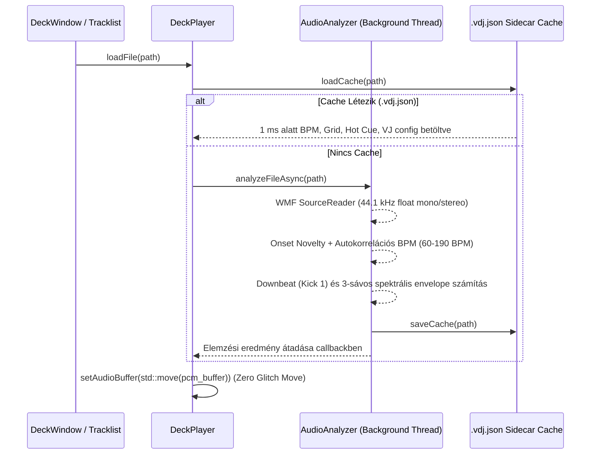

# Audió Motor & DSP Specifikáció (AUDIO_ENGINE)

Ez a dokumentum a hangdekódolás, a memóriapufferelés, a valós idejű 48 kHz DSP szűrés, a BPM/Beatgrid elemzés és a független fejhallgató CUE alrendszer részletes leírását tartalmazza.

---

## 1. FORRÁSFAJLOK ÉS FŐ OSZTÁLYOK
* **`src/audio-analyzer.hpp` & `.cpp`:** `AudioAnalyzer` (Windows Media Foundation aszinkron dekódolás, valódi BPM detektálás, Kick transient és Downbeat keresés, `.vdj.json` gyorsítótárazás).
* **`src/deck-engine.hpp` & `.cpp`:** `DeckPlayer` (PCM RAM puffer, Play/Pause/CUE állapotgép, 3-sávos EQ és DJ Filter, élő Envelope Follower, Auto-Loop logika).
* **`src/wasapi-output.hpp` & `.cpp`:** `WasapiOutput` (Közvetlen Windows Core Audio / WASAPI endpoint streaming a dedikált DJ füles kimenetre, pl. Behringer XR18 OUT 3-4).

---

## 2. AUDIÓ BETÖLTÉSI FOLYAMAT ÉS RAM PUFFERELÉS

### Kulcspontok:
* **Teljes sávhossz támogatás:** Akár 4 órás mixek és hosszú szettek elemzése mesterséges korlát nélkül.
* **Memóriamásolás nélküli átadás:** A dekódolt PCM hangminta `std::move` rvalue szemantikával kerül a `DeckPlayer` memóriájába, megelőzve a 300+ MB-os RAM újrafoglalási mikro-akadásokat.
* **Oldalkocsi gyorsítótár (`.vdj.json`):** Első betöltéskor azonnal lementi a zene mellé az összes metadatot, a 3-sávos spektrumot, a Hot Cue pontokat és az elmentett VJ beállításokat. Ismételt betöltéskor 0% CPU terheléssel 1 ms alatt indul.

---

## 3. VALÓS IDEJŰ 48 kHz DSP JELFELDOLGOZÁS (`processAudioDsp`)

A hangminták a dekóderből 48 kHz-es lebegőpontos (`float*`) formátumban érkeznek a `DeckPlayer::processAudioDsp` metódusba, ahol csatornánként (Left, Right) fut le a szűrés:

### 3.1. 3-Sávos EQ (Isolator / Kill Filter)
* **LOW (Mély):** Másodrendű Low-Shelf IIR szűrő (~250 Hz vágási frekvencia).
* **MID (Közép):** Másodrendű Peaking EQ IIR szűrő (~1000 Hz középfrekvencia, Q = 1.0).
* **HIGH (Magas):** Másodrendű High-Shelf IIR szűrő (~2500 Hz vágási frekvencia).
* **Középállás:** 1.0f (0 dB tiszta transzparens átvitel).
* **Tartomány:** 0.0f (teljes sávnémítás / kill) és 2.0f (+6 dB kiemelés) között.

### 3.2. Bipoláris DJ Filter (Low-Pass / High-Pass)
* **Középen (0.50f):** A szűrő inaktív, tiszta transzparens hang.
* **Balra tekerve (< 0.50f):** 12 dB/oktávos rezonáns Low-Pass (aluláteresztő) szűrő; a magas- és középtartomány fokozatosan elcsendesedik.
* **Jobbra tekerve (> 0.50f):** 12 dB/oktávos rezonáns High-Pass (felüláteresztő) szűrő; a mélyhangok és lábdob fokozatosan kiszűrődnek.
* **Recsegésvédelem:** A filter állapotváltozója nullára ugrás helyett exponenciális csillapítással simul el (`st.dj_hp += 0.05f * (0.0f - st.dj_hp)`), megszüntetve a kattanásokat.

### 3.3. Élő DSP Envelope Follower (Valós Idejű Kick & Amplitúdó Követő)
A shader visualizerek számára a valódi hangmintákból számolunk azonnali energiamutatókat:
* **`live_amp_` (RMS Hangerő):** Pillanatnyi összhangerő 0.0f és 1.0f között.
* **`live_bass_` (Lábdob / Bass Transient):** 160 Hz aluláteresztő energiája.
  * **Támadás (Attack):** Azonnali ~5 ms-os ugrás leütéskor.
  * **Lecsengés (Decay):** Zenei ~60 ms-os simítás (`val * 0.88f`), megelőzve a vibrálást.
* **`live_mid_` és `live_high_`:** Közép és magas frekvenciás energiaszintek a tónuskövetéshez.

---

## 4. WASAPI FEJHALLGATÓ CUE KIMENET (`WasapiOutput`)

Az OBS Studio natívan globálisan csak 1 monitoring eszközt támogat. Annak érdekében, hogy a fejhallgató CUE hangja ne szólaljon meg a közönség felé a Master hangfalakon (OUT 1-2):
1. **Dedikált WASAPI Engine:** A `WasapiOutput` osztály Windows Core Audio API-n keresztül közvetlenül a DJ hangkártya (pl. Behringer XR18 OUT 3-4 vagy Traktor S2 Headphone) endpointjára nyit egy független sztereó audio folyamot.
2. **Valódi Pre-Fade CUE & PGM Keverés:**
   * A CUE gomb (`[ 🎧 CUE A ]`, `[ 🎧 CUE B ]`) a fader előtti jelszintet figyeli (Pre-Fade Listen).
   * A **CUE/PGM potméter:**
     * 0% (balra): Tiszta előhallgatás (PFL CUE).
     * 100% (jobbra): A kimenő Master adás (PGM).
     * 50% (középen): 50-50% arányos keverék az ütemillesztéshez.
3. **OBS Némítás:** A plugin belső CUE forrása `OBS_MONITORING_TYPE_NONE` és `mixers = 0` beállítású, így a master streamre/felvételre sosem jut ki a füles hangja, de a szintek az OBS hangkeverőben élőben láthatók.

---

## 5. ÜTEMRÁCS (BEATGRID), KVANTÁLÁS ÉS AUTO-LOOP

* **Valódi BPM Számítás:** 500 Hz felbontású Onset Novelty görbe és autokorreláció 3 pontos parabolikus interpolációval (0.05 BPM pontosság).
* **Kvantált Áttekintő Keresés:** Az áttekintő hullámformába kattintva a pozíció a legközelebbi taktusvonalra ugrik (`quantizeToBeatgrid`), így lejátszás közben sem esik szét a szinkron.
* **Kvantált Hot Cue-k (1–4):** A 4 gyorsgomb rögzítése és lejátszáskori leütése fázis-helyesen a legközelebbi taktusvonalhoz húz.
* **Varratmentes Auto-Loop (1/2 – 32 ütem):**
  * Ütemhossz: `loop_ms = (beats * 60 000.0) / (bpm * speed)`.
  * Kettős ellenőrzés (GUI és render ciklus) 40 ms-os debounce védelemmel, megakadályozva a visszaugrás átcsúszását vagy a dekóder túlterhelését.
