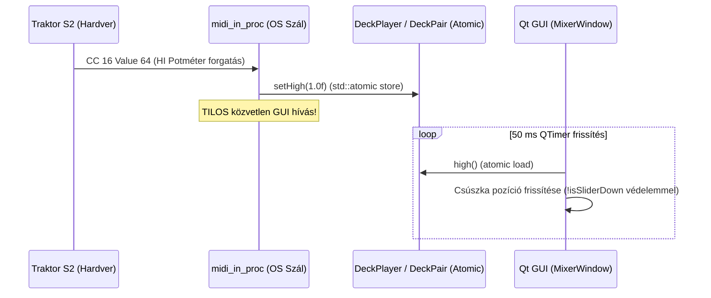

# MIDI Hardver & Vezérlés Specifikáció (MIDI_HARDWARE)

Ez a dokumentum a Native Instruments TRAKTOR KONTROL S2 MK3 hardveres kontroller USB MIDI illesztését, az eseménykezelést és a szálbiztonsági szabályokat tartalmazza.

---

## 1. FORRÁSFAJLOK ÉS FŐ OSZTÁLYOK
* **`src/midi-handler.hpp` & `.cpp`:** `MidiHandler` (Windows Multimedia API illesztő, eszközfelderítés, bejövő üzenetek szálbiztos feldolgozása).

---

## 2. HARDVER ÉS ILLESZTŐFELÜLET
* **Eszköz:** **Native Instruments TRAKTOR KONTROL S2 MK3**
* **Mód:** USB MIDI mód (az eszköz automatikusan ebbe a módba vált, vagy a Shift gombbal kapcsolható).
* **Driver API:** Windows Multimedia API (`winmm.lib`):
  * `midiInGetNumDevs()`, `midiInGetDevCaps()` az eszközök listázására és nevének lekérdezésére.
  * `midiInOpen()` az aszinkron `midi_in_proc` callback regisztrálásával.
  * `midiInStart()`, `midiInStop()`, `midiInClose()`.
* **Automatikus Felderítés:** A bővítmény a név alapján automatikusan megkeresi és rákapcsolódik a kontrollerre, ha a névben megtalálható a `"traktor"` vagy `"s2"` karaktersorozat.

---

## 3. TRAKTOR KONTROL S2 MK3 MIDI KIOSZTÁSI TÁBLÁZAT

| Kezelőszerv | Típus | Csatorna & Azonosító | Plugin Célfunkció | Matematika / Skálázás |
| :--- | :--- | :--- | :--- | :--- |
| **Deck A HI** | Control Change | Ch 1, CC 16 (0–127) | Deck A Vörös (Red) & Magas EQ | `val / 63.5f` $\rightarrow$ $0.0 - 2.0$ (közép: 1.0) |
| **Deck A MID** | Control Change | Ch 1, CC 17 (0–127) | Deck A Zöld (Green) & Közép EQ | `val / 63.5f` $\rightarrow$ $0.0 - 2.0$ (közép: 1.0) |
| **Deck A LOW** | Control Change | Ch 1, CC 18 (0–127) | Deck A Kék (Blue) & Mély EQ | `val / 63.5f` $\rightarrow$ $0.0 - 2.0$ (közép: 1.0) |
| **Deck A FILTER** | Control Change | Ch 1, CC 19 (0–127) | Deck A DJ Filter & Szaturáció | `val / 63.5f` $\rightarrow$ $0.0 - 2.0$ (közép: 1.0) |
| **Deck A VOL FADER**| Control Change | Ch 1, CC 20 (0–127) | Deck A Csatorna Hangerő | `val / 127.0f` $\rightarrow$ $0.0 - 1.0$ |
| **Deck A TEMPO** | Control Change | Ch 1, CC 21 (0–127) | Deck A Sebesség (Pitch Fader) | $50 + (val \times 100) / 127$ $\rightarrow$ $50\% - 150\%$ |
| **Deck A PLAY** | Note On ($vel > 0$) | Ch 1, Note 35 | Deck A Play / Pause váltás | Állapotfüggő toggle |
| **Deck A CUE** | Note On ($vel > 0$) | Ch 1, Note 36 | Deck A CUE ugrás / mentés | Lejátszáskor: ugrás + pause; Álláskor: CUE mentés |
| **Deck A SYNC** | Note On ($vel > 0$) | Ch 1, Note 37 | Deck A Sync Deck B-hez | Tempó és fázis átvétele |
| **Deck A CUE PFL** | Note On ($vel > 0$) | Ch 1, Note 38 | Deck A Fejhallgató Előhallgatás| Fejhallgató kapcsoló toggle |
| **Deck B HI** | Control Change | Ch 2, CC 16 (0–127) | Deck B Vörös (Red) & Magas EQ | `val / 63.5f` $\rightarrow$ $0.0 - 2.0$ (közép: 1.0) |
| **Deck B MID** | Control Change | Ch 2, CC 17 (0–127) | Deck B Zöld (Green) & Közép EQ | `val / 63.5f` $\rightarrow$ $0.0 - 2.0$ (közép: 1.0) |
| **Deck B LOW** | Control Change | Ch 2, CC 18 (0–127) | Deck B Kék (Blue) & Mély EQ | `val / 63.5f` $\rightarrow$ $0.0 - 2.0$ (közép: 1.0) |
| **Deck B FILTER** | Control Change | Ch 2, CC 19 (0–127) | Deck B DJ Filter & Szaturáció | `val / 63.5f` $\rightarrow$ $0.0 - 2.0$ (közép: 1.0) |
| **Deck B VOL FADER**| Control Change | Ch 2, CC 20 (0–127) | Deck B Csatorna Hangerő | `val / 127.0f` $\rightarrow$ $0.0 - 1.0$ |
| **Deck B TEMPO** | Control Change | Ch 2, CC 21 (0–127) | Deck B Sebesség (Pitch Fader) | $50 + (val \times 100) / 127$ $\rightarrow$ $50\% - 150\%$ |
| **Deck B PLAY** | Note On ($vel > 0$) | Ch 2, Note 35 | Deck B Play / Pause váltás | Állapotfüggő toggle |
| **Deck B CUE** | Note On ($vel > 0$) | Ch 2, Note 36 | Deck B CUE ugrás / mentés | Lejátszáskor: ugrás + pause; Álláskor: CUE mentés |
| **Deck B SYNC** | Note On ($vel > 0$) | Ch 2, Note 37 | Deck B Sync Deck A-hoz | Tempó és fázis átvétele |
| **Deck B CUE PFL** | Note On ($vel > 0$) | Ch 2, Note 38 | Deck B Fejhallgató Előhallgatás| Fejhallgató kapcsoló toggle |
| **CROSSFADER** | Control Change | Ch 1, CC 8 (0–127) | Master Kép- és Hangkeverő | `val / 127.0f` $\rightarrow$ $0.0$ (A) és $1.0$ (B) között |

*Megjegyzés:* A Traktor S2 gomboknál a gomb felengedése Note On 0 velocity formájában érkezik, amit a driver figyelmen kívül hagy; kizárólag a valós lenyomás ($vel > 0$) vált ki eseményt.

---

## 4. SZÁLBIZTONSÁG ÉS KÉTIRÁNYÚ SZINKRONIZÁCIÓ

### 4.1. Visszaugrás-védelem (Jitter Protection):
Amikor a felhasználó egérrel mozgat egy csúszkát a képernyőn, a `!isSliderDown()` vizsgálat megakadályozza, hogy a háttérben érkező időzítő felülírja a csúszka pozícióját, garantálva a sima, akadásmentes egérmozgást.
