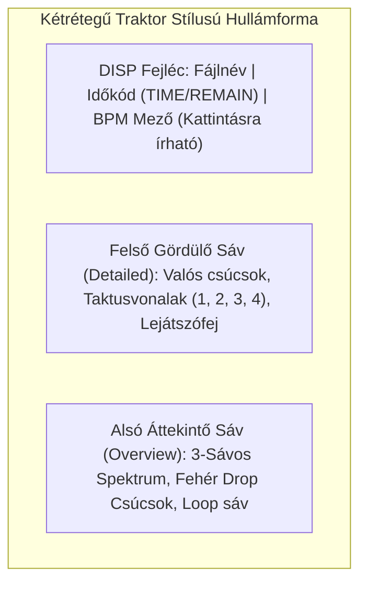

# Kezelőfelület & Widgetek Specifikáció (UI_COMPONENTS)

Ez a dokumentum a Qt 6 alapú felhasználói felületeket, az ablakméreteket, a színkonvenciókat, a Waveform grafikát és az interaktív vezérlőket részletezi.

---

## 1. FORRÁSFAJLOK ÉS FŐ OSZTÁLYOK
* **`src/gui/deck_window.hpp` & `.cpp`:** `DeckWindow` (Független lebegő Deck A és Deck B lejátszó ablakok).
* **`src/gui/mixer_window.hpp` & `.cpp`:** `MixerWindow` (Központi keverőpult), `DJSlider` (Duplaklikkes reset potméter).
* **`src/gui/vj_fx_dialog.hpp` & `.cpp`:** `VjFxDialog` (VJ paraméter ablak).
* **`src/waveform/waveform_widget.hpp` & `.cpp`:** `WaveformWidget` & `WaveformCanvas` (Zenei hullámforma és BPM sáv).
* **`src/gui/tracklist_dock.hpp` & `.cpp`:** `TracklistDock` (Médiakönyvtár, drag-and-drop és videókonvertáló).

---

## 2. ABLAKARCHITEKTÚRA ÉS FIX MÉRETKORLÁTOK

A felületek **nem OBS dokkoló panelek**, hanem független lebegő dialógusok (`QDialog` / `Qt::Window`), amelyek az OBS felső **Eszközök (Tools)** menüjéből nyithatók meg, elkerülve az OBS felületének vibrálását és szétesését.

| Ablak | Cím / Menüpont | Méret (Fix) | Főbb Vezérlők |
| :--- | :--- | :---: | :--- |
| **DeckWindow A** | `Eszközök -> OBS VJ Deck A` | **640 × 430 px** | 175 px Waveform (135 px Detailed + 38 px Overview), Jog Scratch, 4 Hot Cue, Loop Mátrix (1/2–32), Pitch Fader, TAP melletti közvetlen BPM mező és /2, x2 gombok |
| **DeckWindow B** | `Eszközök -> OBS VJ Deck B` | **640 × 430 px** | Megegyezik a Deck A-val, narancssárga kiemeléssel |
| **MixerWindow** | `Eszközök -> Video DJ Mixer` | **590 × 340 px** | 3-sávos EQ (0 középérték, negatív vágás, előjel nélküli erősítés) és Gain, `[ ⇄ BGR ]` inverzió, Filter, Master Crossfader, `[ ⚙ BEÁLLÍTÁSOK ]`, CUE/PGM füles mix, WASAPI választó, OBS T-Bar szinkron |
| **TracklistDock** | `Eszközök -> OBS VJ Tracklist` | **640 × 560 px** | Drag-and-drop lista, session zöld pipák, 720p–4K konverter, mini `[ A ]` és `[ B ]` betöltő gombok |
| **VideoFxDialog (VjFxDialog)** | `Eszközök -> OBS VJ Visualizer & FX` | **540 × 560 px** | **Egységes 3-füles ablak:** 1. Fül: VJ Visualizer Shader & Deck A/B váltó (15 shader, ISF konverter), 2. Fül: Crossfade FX (13 átmenet effekt), 3. Fül: BPM-szinkronizált LFO 1 & 2 motor élő oszcilloszkópokkal |
| **Teljes Elrendezés** | `Eszközök -> OBS VJ Teljes Elrendezés (Mind az 5 ablak)` | **1920 × 1080** | Mind az 5 ablakot (Deck A, Mixer, Deck B, Video FX, Tracklist) egyszerre megnyitja és pixelre pontosan elrendezi a monitoron. |

---

## 3. SZÍNKONVENCIÓK (DECK-TÉMÁK)

A kezelőfelületek szigorú színkódolást követnek az összetéveszthetetlenség érdekében:
* **Deck A (Bal oldal):** Elektromos Ciánkék (`#00d2ff`) fejléc, szegélyek, potméter-kiemelések és füles gomb.
* **Deck B (Jobb oldal):** Meleg Borostyán / Narancs (`#ff7700`) fejléc, szegélyek, potméter-kiemelések és füles gomb.
* **Háttér & Keretek:** Sötét Traktor Pro stúdió téma (`#11141a`, `#161b22`, `#1f2733`).

---

## 4. WAVEFORM ÉS BEATGRID GRAFIKA (`WaveformWidget`)

### 4.1. Interaktív Jog Scratch (Egérrel Húzható Hullámforma)
* **Kattintás és húzás:** A felső hullámformára bal egérgombbal kattintva az időkód és a hang azonnal követi az egér mozgását (`delta_x` relatív mozgatás).
* **Lejátszásmegőrzés:** Ha lejátszás közben fogjuk meg, a zene átmenetileg megáll, majd felengedéskor (`mouseReleaseEvent`) azonnal folytatódik a lecsúsztatott új pozícióból.

### 4.2. 3-Sávos Spektrális Színezés & Kontraszt
Az alsó áttekintő sáv a zene valós frekvenciaspektrumát mutatja Pioneer CDJ / Traktor Pro stílusban:
* **Mélyhangok (< 250 Hz):** Mély kék (`#0044ff`) a lábdobnál és basszusnál.
* **Középtartomány (250–2500 Hz):** Meleg arany / borostyán (`#ff9900`) a dallamoknál és vokálnál.
* **Magashangok (> 2500 Hz):** Elektromos cián (`#00f0ff`) a lábcinnél és zajoknál.
* **Fehér Csúcsok (`#ffffff`):** A masszív dropoknál, ahol mindhárom sáv egyszerre szól, a színek ragyogó fehérré olvadnak össze (`pow(1.8)` nemlineáris kontraszt-kiemeléssel).

### 4.3. Helyben Szerkeszthető BPM Mező
* A BPM kiírásra kattintva közvetlenül átírható az érték (pl. `128.00` $\rightarrow$ Enter), felugró modális ablakok nélkül.
* A `[ − ]` és `[ + ]` gombok az első kattintásra a legközelebbi kerek tizedre ugranak, utána 0.10 BPM-et léptetnek.

---

## 5. TRACKLIST ÉS KONVERTER (`TracklistDock`)

* **Munkamenet-alapú Lejátszási Pipák:** A lejátszott zenék mellett megjelenő zöld pipák (`played = true`) csak az aktuális OBS munkamenet alatt élnek; nem íródnak a lemezre, így új műsor indításakor tiszta lappal indul a lista.
* **Új Szett Kezdés Gomb:** A lista fejlécében lévő `[ ↻ ÚJ SZETT ]` gombbal bármikor manuálisan is törölhetők a pipák.
* **Multi-Felbontású Konverter (720p – 4K):**
  * Profilok: `[ 720p | 1080p | 1440p | 4K | Eredeti ]`.
  * **Szigorú felskálázás-gátló:** A célfelbontás sosem haladja meg az eredeti videó méretét (`min(orig, target)`), megóvva a GPU-t a felesleges terheléstől.
