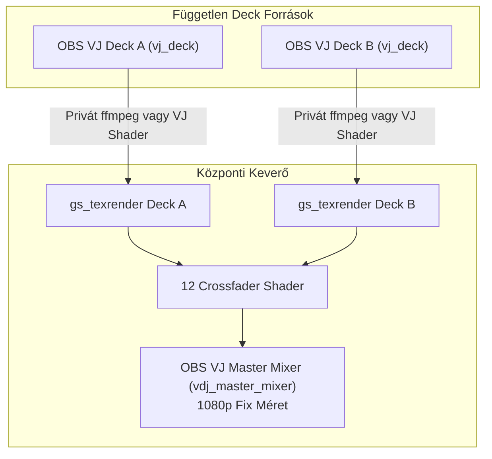

# Videó Renderelés & Shaders Specifikáció (VIDEO_SHADERS)

Ez a dokumentum az OBS videó források életciklusát, a GPU méretezést, a 12 Master Crossfader shader effektet, a 12 ISF Audio-Reaktív visualizer shadert és a számszintű `.vdj.json` mentést részletezi.

---

## 1. FORRÁSFAJLOK ÉS FŐ ELEMEK
* **`src/video/deck_source.cpp`:** `vj_deck` forrás (Deck A és Deck B egyedi videó/audió kimenete az OBS jelenetekben).
* **`src/video/mixer_source.cpp`:** `vdj_master_mixer` forrás (A 2 decket összefűző 1080p Master kimenet, T-Bar vezérléssel).
* **`src/effects/vj_config.hpp`:** VJ shader definíciók, paraméter-táblázatok és hatásos paraméterszámítás (`computeEffectiveParam`).
* **`src/effects/vj_shaders.hpp`:** A 12 beágyazott ISF HLSL shader forrása (kompromisszummentes, eredeti forrásokhoz hű 3D raymarching).
* **`src/effects/crossfade.effect`:** A 12 Master Crossfader shader forrása.

---

## 2. OBS FORRÁS ARCHITEKTÚRA ÉS MÉRETEZÉS



### 2.1. A Három OBS Forrás
1. **`OBS VJ Deck A` (`vj_deck_a`):** Bal oldali deck. Közvetlenül OBS szűrők tehetők rá az OBS jelenetben.
2. **`OBS VJ Deck B` (`vj_deck_b`):** Jobb oldali deck.
3. **`OBS VJ Master Mixer` (`vdj_master_mixer`):** A fő jelenet tetejére helyezve a Crossfader arányában összefűzi a Deck A és Deck B képét és hangját.

### 2.2. GPU Vászon Méretezés (Scale Mode)
A `DeckPair::videoScaleMode` vezérli mind a preview-kat, mind a Master vásznat:
* **`FIT` (Aránytartó):** A teljes kép látható; ha a videó és az OBS vászon képaránya eltér, fekete sávokkal egészíti ki (letterbox / pillarbox).
* **`FILL` (Teljes vászonkitöltés):** A videó kitölti a teljes 1080p vásznat fekete sávok nélkül (szükség esetén középre vágással).
* **`STRETCH` (Nyújtás):** Közvetlen nyújtás a teljes felületre.
* **Gomb a felületen:** A Master Mixer ablakban a `[ 📺 FILL ]` / `[ 📺 FIT ]` gombbal azonnal váltható.

---

## 3. 12 MASTER CROSSFADER SHADER EFFEKT & PARAMÉTEREZHETŐSÉG

A Master Mixer 12 zenei képi átmenetet biztosít, amelyek a crossfader mozgatásakor fokozatosan fejtik ki hatásukat:
1. **Linear Fade:** Standard lineáris fényerő átúsztatás.
2. **Horizontal Wipe:** Vízszintes tolás / söprés élsimítással.
3. **Additive Blend:** Fényesítő additív átolvasztás (ideális dropokhoz és lámpákhoz).
4. **Hard Cut:** Határozott vágás a felezőponton (0.50).
5. **Swirl:** Örvénylő csavarás a kép középpontjából.
6. **Fisheye:** Dinamikus halszemoptika görbület.
7. **RGB Split (Kromatikus Aberráció):** Vörös és kék csatornák szétcsúszása.
8. **Radial Zoom Blur:** Sugárirányú sebességelmosás a középpontból.
9. **Pixelate:** Mozaikszerű pixelesedés a felezőponton.
10. **Luma Dissolve:** Fényesség-alapú zajos feloszlás és arany parázslás.
11. **Ripple (Folyadék Hullámzás):** Körkörös vízfodrozódás és törés.
12. **Kaleidoscope (Mirror Fold):** 8-ágú tükröződő kaleidoszkóp forma.
13. **Glitch & Scanline:** Digitális adáshiba és CRT képsorok.
14. **Pop-Art Halftone:** Képregény nyomdai pontrács.
15. **Neon Sobel Edge:** Éldetektált neonszínű körvonalak.

### 3.1. Crossfader FX Kifordított Paraméterek & Egyedi Zenei Moduláció (`CrossfadeFxDialog`)
A Crossfader melletti **`[ ⚙ FX ]`** gombbal megnyitható a Crossfader Vizuális FX beállító ablaka (480 × 440 px):
* **Effektenként Kifordított 8 Egyedi Paraméter (`src/effects/crossfade_fx_config.hpp`):**
  - **Kaleidoszkóp (Mirror Fold):** `sides` (Tükrök száma: 2–16), `rot_speed` (Forgási sebesség), `zoom`, `fold_angle`, `center_x`, `center_y`, `blend`.
  - **Spirális Örvény (Swirl Vortex):** `twist` (Csavarás szöge), `radius`, `dir` (Forgásirány), `zoom`, `center_x`, `center_y`.
  - **Halszem Optika (Fisheye Lens):** `distortion`, `zoom`, `vignette`, `center_x`, `center_y`.
  - **RGB Split (Kromatikus Aberráció):** `distance` (Szétválási távolság), `angle`, `green_shift`, `blur`, `sat_boost`.
  - **Radial Zoom Blur:** `amount`, `samples`, `center_x`, `center_y`, `decay`, `glow`.
  - **Pixelesedés (Pixelate):** `max_grid`, `min_grid`, `aspect`, `grid_border`, `color_quant`.
  - **Luma Dissolve:** `softness`, `glow`, `glow_r`, `glow_g`, `glow_b`, `invert`.
  - **Folyadék Hullámzás (Liquid Ripple):** `wave_count`, `speed`, `amplitude`, `aspect_x`, `decay`, `surge`.
  - **Glitch Displacement:** `bands`, `speed`, `shift`, `jitter_freq`, `color_split`.
  - **CRT / VHS Scanline:** `density`, `intensity`, `curvature`, `flash`, `vignette`.
  - **Pop-Art Halftone:** `grid_x`, `grid_y`, `dot_size`, `softness`, `posterize`, `brightness`.
  - **Neon Kontúr (Sobel Edge):** `thickness`, `glow`, `neon_color`, `threshold`, `blend_base`.
  - **Normál Átúsztatás (Fade):** `curve` (Görbület), `smoothness` (S-Curve lágyság).
* **Egyenkénti Zenei Mozgató / Modulációs Algoritmusok (Minden paraméterhez külön-külön választható!):**
  1. `🥁 Kick Pulzus (Beat Pulse)`: A leütések pillanatában azonnal megrántja az adott paraméter értékét a lábdob transient energiája (`bass_energy`) alapján.
  2. `📈 Zenei Tónus (Macro-Tonus)`: A sáv makroszkopikus felépülését, zenei sűrűsödését követi le Gauss-simított energiagörbével (`macro_tonus`), a kiállásoktól a dropig fokozva a paraméter hatását.
  3. `⚡ Mindkettő (Both)`: Kombinálja a gyors lábdob lüktetést és a makroszkopikus felépülést.
  4. `✋ Kézi (Off)`: Statikus potméter beállítás.
* **Effektenkénti Memória:** Minden Crossfade FX egyedi paraméter-beállítása külön-külön tárolódik a memóriában, így effektek közötti váltáskor minden korábbi beállítás megmarad.

---

## 4. 15 ISF AUDIO-REAKTÍV VISUALIZER SHADER (TISZTA AUDIÓHOZ)

Ha egy deckbe nem videófájlt, hanem tiszta audiófájlt (`.mp3`, `.wav`) töltünk be, a fekete kép helyett azonnal elindul a Direct3D 11 / OpenGL procedurális shader:

| Index | Név | Kategória | Kifordított Paraméterek |
| :---: | :--- | :--- | :--- |
| **0** | **Fluid Flow 3D** | Organikus 3D Folyadék | `rate` (sebesség), `zrate` (Z-áramlás), `depth` (mélység), `blur` (elmosás), `freq`, `freq2` |
| **1** | **Truchet Spin 3D** | 3D Raymarch Labirintus | `rate`, `zoom`, `thickness` (vastagság), `pulse` (pulzus) |
| **2** | **Hypno Worm** | 24-Lépéses OpArt Alagút | `rate`, `size`, `edge` (élesség), `amp1`, `amp2` |
| **3** | **Shape Twist** | 18-Lépéses Elektro Hullám | `rate`, `zoom`, `amplitude`, `thickness`, `twist` |
| **4** | **String Art** | Szálművészet | `rate`, `scale`, `freq1`, `freq2`, `radius1`, `radius2`, `thickness` |
| **5** | **Dodecahedron 3D**| 3D Kristály Raymarch | `zoom`, `een`, `twee`, `drie`, `vijf` (fényerő), `acht` (aranyarány) |
| **6** | **Kali Circuits**| Fraktál Áramkörök | `rate`, `zoom`, `intensity`, `focus`, `pulse`, `glow` |
| **7** | **Diamond Vision**| 36-Lépéses Tórusz Raymarch | `speed`, `bat`, `ray`, `hue`, `rotation`, `ratio` |
| **8** | **Pupila** | Organikus Szem & Írisz | `zoom`, `irisR`, `irisG`, `irisB`, `borderR`, `borderG`, `borderB`, `pupilPulse` |
| **9** | **MandalaScope** | 72-Lépéses Fraktál Mandala | `rate`, `sides`, `scale`, `multiply`, `loops`, `mX`, `mY`, `pulse` |
| **10**| **Searching Light** | Kiber Fényalagút | `scale`, `modVal`, `zAdder`, `cosinAdder`, `sinAdder`, `finalMulti`, `pulse` |
| **11**| **CubeField 3D** | Végtelen Kockamező Raymarch | `speed`, `rot_z`, `repeat`, `box_size`, `squiggle`, `dist1`, `dist3`, `termThres` |
| **12**| **Electro Bands** | Pulzáló Neon Szalagok | `radius`, `amp`, `band`, `speed`, `thickness`, `size` |
| **13**| **GlobularCluster** | 3D Gömbhalmaz Torzulás | `rate`, `warpx`, `warpy`, `warpz`, `melt`, `density`, `depth`, `tint` |
| **14**| **HexTruchWarpFlow2**| Hexagonális Truchet Áramlás | `scale`, `rate`, `motion`, `thickness`, `warp`, `arrows`, `dashes`, `pulse` |

### 4.1. Paraméter Modulációs Módok (C++ oldalon számítva):
Minden paraméterhez 4-féle mód választható a felületen:
* `0: ✋ Kézi (Manual / Off)`: A csúszkával rögzített fix érték.
* `1: 🥁 Zene Üteme (Beat Pulse)`: Lábdob és mélyhang tranziensekre lüktet (`bass_energy`).
* `2: 🌈 Tónusos (Spectral Tone)`: A spektrum magas/mély arányára modulál (`tone_balance`).
* `3: ⚡ Mindkettő (Both)`: Szimultán lüktetés és tónuskövetés.

### 4.2. MSVC C2026 Védelem:
Az óriási HLSL kód a fordító korlátjának (16 380 karakteres string literál) kikerülésére 4 önálló darabban van definiálva, amit a `getVjVisualizerEffect()` függvény fűz össze `std::string` formájában az első híváskor.

---

## 5. OLDAKKOCSI GYORSÍTÓTÁR (`.vdj.json`) SPECIFIKÁCIÓ

Minden médiafájl mellé közvetlenül elmentésre kerül egy kompakt JSON leíró. Példa felépítés:

```json
{
  "version": 2,
  "bpm": 128.00,
  "grid_offset_ms": 142,
  "cue_point_ms": 0,
  "duration_ms": 348000,
  "hot_cues": [0, 15000, 45000, 90000],
  "overview_peaks": [0.12, 0.45, 0.89, ...],
  "overview_low": [0.08, 0.40, 0.95, ...],
  "overview_mid": [0.05, 0.25, 0.60, ...],
  "overview_high": [0.02, 0.15, 0.40, ...],
  "detailed_peaks": [0.10, 0.35, 0.92, ...],
  "vj_shader": {
    "shader_idx": 2,
    "params": [
      {"val": 1.5, "mod": 1},
      {"val": 8.95, "mod": 0},
      {"val": 23.0, "mod": 2},
      {"val": 0.10, "mod": 3},
      {"val": 0.05, "mod": 0}
    ]
  }
}
```
* **Automatikus betöltés:** A dal betöltésekor a `DeckPlayer::loadVjConfigFromCache()` azonnal visszaállítja a kiválasztott VJ shadert és paraméterkiosztást.
